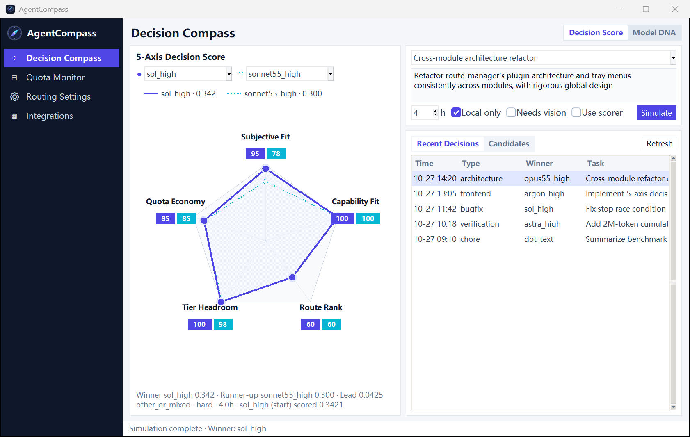
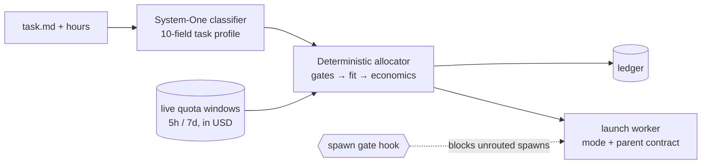

<div align="center">

# 🧭 AgentCompass

**Opus for architecture. Flash for chores. Dot for anything that doesn't need your machine.<br>
Decided by arithmetic, not habit.**

A deterministic **multi-agent task router and subscription quota scheduler** for the **flat-rate AI subscriptions** you
already pay for: **Claude Code** (Claude Max / Pro), **OpenAI Codex CLI** / **ChatGPT Pro**, **Google Antigravity** (`agy` / Gemini CLI),
**Grok**, and **Paseo**. Unlike per-token API prompt routers (RouteLLM, OpenRouter), AgentCompass dispatches **sub-agents per task** —
matching each brief to the most economical `model × effort` worker that clears the ability floor, pricing the choice in
API-equivalent dollars against live 5-hour and 7-day rate-limit windows, spending surplus before weekly resets, rotating workers at
2M cumulative context tokens, and enforcing a `PreToolUse` spawn gate.




<sub>The author's Windows cockpit (optional). The router underneath is a portable Python Agent Skill (<code>SKILL.md</code>) with JSON config · <a href="llms.txt"><code>llms.txt</code></a></sub>


</div>

### One real decision

```text
$ route_judge.py plan --input examples/task.json --dry-run
task      other_or_mixed · routine · 1.5 h · local_only (runs pytest)
winner    argon_high   score 0.2589
          gemini-weekly: 63% left ($158.19), this work ~2.4% (~$6.00),
          other work wants ~48% before its reset in 89h → opportunity cost 0.0211
runner-up sol_high     score 0.2528   (codex: 83% left, but observed demand ~84% before reset in 144h)
excluded  dot          local_only: needs this machine
```

No LLM makes the final call. A lightweight System-One classifier profiles the task brief, and a deterministic allocator
ranks every signed-in `model × effort` bundle against ability floors, task fit, and quota economics. Every decision is
recorded in an auditable, replayable ledger.

### Try it

```bash
# 1. Offline demo: no credentials, provider CLIs, or quota cache needed
python -X utf8 skills/route-agent-work/scripts/route_judge.py plan --input examples/task.json --dry-run --demo

# 2. First-run onboarding: detect your signed-in CLIs, choose which accounts the router may use,
#    fetch the usage collector, link the router skill and write the global agent rules.
#    It asks before each step, backs up every file it changes, and never installs the spawn gate unless you say so.
python -X utf8 setup/onboard.py            # add --dry-run to preview, --yes for non-interactive defaults

# 3. Rank your own machine's signed-in providers using its local quota observations
python -X utf8 skills/route-agent-work/scripts/route_judge.py plan --input examples/task.json --dry-run

# Undo everything onboarding did (managed blocks, hook entries, junctions, Paseo prompt, account choices)
python -X utf8 setup/onboard.py uninstall

# Or hand it to your coding agent
"Read this repository. Run setup/onboard.py --dry-run, show me what it would change, then run it and show me how the router routes this task: <your task>"

```

Until onboarding has run (or an account is signed in and the usage collector has produced a snapshot) the router does not
guess: `plan`/`roll` return `no_ready_account` (no choice) when nothing is signed in, and carry a `no_usage_data` warning
when there are no quota readings, both pointing back at `setup/onboard.py`.

Run these commands from the repository root with Python 3.10+. The demo prints a ranked table using a fixed,
synthetic quota snapshot and the reference fleet; it makes no network calls, writes no ledger, and launches no workers.
It uses the same 1.5-hour local coding/test scenario as the historical decision above; scores change with policy and
quota inputs. Add `--format json` for the full demo breakdown. The normal dry run uses your machine's configuration
and may report no eligible providers until you sign in and collect quotas with [usage-float](https://github.com/akiiwa-games/usage-float).

For Paseo worker dispatch via `roll`, install Node.js with npm, then run
`npm --prefix setup/paseo-bridge ci` from this repository root before dispatching.
These bridge dependencies are only needed when using Paseo. The host rollout script
also installs them when it detects Paseo and the dependency directory is missing;
if npm is unavailable it prints this command and continues the other host setup.

> **Status: alpha.** Built by a heavy multi-subscription user for a live multi-agent fleet. The shipped
> `accounts.json` and `model-capabilities.json` describe that reference fleet; treat them as an example template to
> customize for your own subscriptions.
> Bundle/model identifiers such as `opus55_high`, `sol_high`, `astra_high`, `argon_high`, and `flash_high` are logical
> fleet capability profiles and aliases calibrated for the author's multi-host setup. Map them to your own provider/model
> IDs in `accounts.json`; they are examples, not a required list of subscriptions.

---

## Why

You pay ~$200/month each for frontier subscriptions whose quota windows reset on a fixed schedule, yet dispatch coding
agents by feel. That fails in five predictable ways:

| Vibe dispatching | AgentCompass |
|---|---|
| Every task gets Opus or Astra "to be safe"; the weekly window is gone by Wednesday. | **Minimum-sufficient ability.** Models far above the task's difficulty floor pay an over-qualification penalty scaled by their $/h burn. Chores go to Flash or the free remote Dot worker. |
| Cross-module refactors go to a model that is sharp inside one file but blind across the repo. | **Model DNA fit.** Each model carries `divergence / global_rigor / module_precision`; repo-wide work with `context_scale = 3` heavily penalizes low-`global_rigor` models. |
| Sunday night, 40% of a weekly window expires unused. | **Pre-reset spend-down.** Within 36 h of a weekly reset, surplus above forecast demand earns up to `+0.20` score so expiring quota gets spent first. |
| A worker five compactions deep keeps "fixing" code it no longer remembers. | **2M-token rotation guard.** Tracks `compacted + live` context across the worker's full history. At 2M tokens, follow-up prompts are blocked and a fresh worker receives a handoff brief. |
| The main agent spawns sub-agents however it likes. | **Spawn gate.** A `PreToolUse` / `tool_call` hook rejects any sub-agent launch without a matching router ledger entry in the last 15 minutes or without a real parent session address. |

## How it decides



```text
score = harness_factor × (0.30·fit + 0.10·ability) + w·continuity
      + reset_bonus + free_usage + boost + quality_bonus
      − opportunity_cost − effort_penalty − overqualification

fit              = 0.17·route_fit + 0.34·capability_fit(6D) + 0.49·model_dna_fit(3D)
harness_factor   = 1.0 (Antigravity Claude 0.9)
expected_usd     = usd_per_hour × hours × burn / 0.70
opportunity_cost = sum over windows of displaced_usd × score_per_displaced_usd (0.012)
```

Same model, different harness: value stays the same unless `harness_factor` says the harness is worse. Codex versus Pi is still a sibling-only `0.03` step (`harness_order`); the best sibling keeps its score. A bundle that draws several pools must clear every window, and the cost above is the sum. The window with the highest cost is the binding window. One score point is about `$83` of displaced subscription USD (`scoring.opportunity_exchange`).

Hard gates run first: local sign-in and credential health, host policy, modality (text-only models never receive visual
work), `local_only`, ability floor by difficulty, and per-window safety reserves net of in-flight work. Weights and
thresholds live in [`accounts.json`](skills/route-agent-work/references/accounts.json); models, prices, and DNA live in
[`model-capabilities.json`](skills/route-agent-work/references/model-capabilities.json).

## What's in the box

| Layer | What it is | Runs on | Required? |
|---|---|---|---|
| **Core**: [`skills/route-agent-work`](skills/route-agent-work/SKILL.md) | Classifier, deterministic allocator, ledger, and `roll` (`classify → allocate → launch` with explicit permission mode and parent-session contract) | Python 3.10+; Windows-first, POSIX-compatible core | **Yes** |
| **Gate**: [`setup/router_gate_hook.py`](setup/router_gate_hook.py) | Spawn gate and 2M-token context rotation guard for Claude Code, Codex, Antigravity, and Paseo | Any host supporting pre-tool hooks | **Opt-in** |
| **Cockpit**: [`tray/`](tray/) | Windows system tray, 5-axis decision compass, live quota HUD ([`usage-float`](https://github.com/akiiwa-games/usage-float)), and local bridges ([`gemini-web`](https://github.com/akiiwa-games/gemini-web), `codex-chatgpt-web`, `dot2api`, `easytier`) | Windows 11 | **Optional** |

**How it differs from prompt routers.** RouteLLM, OpenRouter Auto, and Not Diamond choose a model **per prompt** and
bill **per token**. AgentCompass chooses a **worker per task** and manages **flat-rate subscription windows that
expire**. They solve different layers of the stack and can be used together.

---

## Repository Layout

The companion repositories and runtime directories listed below are separate local checkouts or ignored host state; they are not bundled in this repository. [Usage Float](https://github.com/akiiwa-games/usage-float) provides the standalone quota HUD and collector used by AgentCompass.

| Path | Description |
|---|---|
| `skills/` | Agent skills (`route-agent-work`, `dot-subagent`, `chatgpt-pro-consult`, `gemini-web`). Loaded at the system level across every host: directory junctions in `~/.codex/skills/<name>`, `~/.claude/skills/<name>` (`~/.claude-*/skills`), and `~/.pi/agent/skills/<name>`, plus `~/.gemini/config/skills.json` and materialized real top-level directories in `~/.gemini/skills/<name>` (with live subdirectory junctions) so Antigravity (`agy`) loads them in every workspace. |
| `tray/` | Windows cockpit and service supervisor: `app.pyw` (system tray), `router_window.py` + `router_data.py` + `radar_chart.py` + `ui_theme.py` (decision console and shared UI theme), `plugins.py` (optional plugin registry in `~/.route-manager/plugins.json`), `services.py` (process lifecycle), `updates.py` (fast-forward updater and builder), `chatgpt_web_patch.py` (anchored source patches for ChatGPT Web), `usage_collector.py` (headless subscription quota collector), `capacity_stats.py` (session burn and worker-hour analytics), and `deploy.py`. |
| `audit/` | `router_audit.py`: read-only daily compliance audit checking sub-agent launches against `~/.route-manager/router-ledger.jsonl`. |
| `usage-float/` | Borderless Windows subscription usage HUD and mpv/web live-wallpaper switcher; also serves as the direct local quota collector (`usage_float.py`, `magpie_usage.py`). See [`usage-float/README.md`](https://github.com/akiiwa-games/usage-float#readme). |
| `gemini-web/` | Persistent Google Chrome CDP bridge (`127.0.0.1:17849`) for Gemini, Google AI Studio, and Flow, plus the `omni.py` Gemini Omni 1.1 Flash video runner. See [`gemini-web/README.md`](https://github.com/akiiwa-games/gemini-web#readme). |
| `dot2api/` | Local checkout of `Pluviobyte/dot2api` with its own `.venv`, exposing remote Dot workers behind a Cloudflared quick tunnel. |
| `codex-chatgpt-web/` | Local checkout of `miuuyy/codex-chatgpt-web` and its Electron launcher, driving ChatGPT Pro consultations from local Codex agents. |
| `setup/` | Host bootstrap and synchronization scripts: `onboard.py` (first-run onboarding and uninstall), `sync_host_globals.py` + `host_rules.py` (skills and global rules, reversible), `router_gate_hook.py` (spawn gate), `bootstrap_dot2api.py`, `lock_dot2api_acl.py`, `pi_device_login.mjs`, and `claude2_config.py`. |
| `easytier/` | Per-host EasyTier mesh node directory (untracked runtime files): `bin/`, `private/node.toml`, `logs/`, `state/`, managed by `tray/easytier.py` and `tray/easytier_setup.py`. |
| `tools/bun/` | Pinned Bun runtime used to run the ChatGPT Web bridge and build its launcher. |

---

## Dynamic Provider Inventory & Quota Discovery

AgentCompass discovers local account availability on every allocation through
[`skills/route-agent-work/scripts/provider_inventory.py`](skills/route-agent-work/scripts/provider_inventory.py) without making network calls:

- **Multi-Source Local Discovery**: Inspects native CLI sign-ins (`~/.claude`, `~/.claude-*`, `~/.codex`, `~/.codex-*`, `~/.grok`, `agy`), Paseo provider bindings (`~/.paseo/config.json`), CC Switch SQLite provider/health records, and Magpie gateway configurations (`usage-float.json` / `settings.json`).
- **Automatic Pause & Resume**: Disabled or removed accounts, rejected credentials, or plugins turned off in the cockpit (`status=paused`, `reason=plugin_disabled_in_route_manager`) are excluded automatically on the next allocation and resume as soon as credentials or plugins are restored.
- **Deduplicated Quota Owners**: Duplicate launchers or aliases pointing to the same underlying subscription share a single quota owner so concurrent tasks never double-count remaining allowance.

Inspect the live inventory at any time:

```bash
python -X utf8 skills/route-agent-work/scripts/route_judge.py providers
```

### Direct Subscription Quota Collection (`usage-float` + `usage_collector.py`)

Quota windows are collected directly by [`usage-float/usage_float.py`](https://github.com/akiiwa-games/usage-float/blob/main/usage_float.py) and scheduled headlessly by [`tray/usage_collector.py`](tray/usage_collector.py) every 5 minutes into `~/.usage-float/usage-cache.json` (with a diagnostic receipt at `~/.route-manager/usage-collector.json`):

- **Dynamic Multi-Account Discovery**: Automatically detects primary and additional Claude homes (`~/.claude`, `~/.claude-2`, `~/.claude-*`), Codex homes (`~/.codex`, `~/.codex-2`, `~/.codex-*`), Paseo-configured account directories, and remote Magpie gateways (`magpie_usage.py`).
- **Activity-Aware Polling Cadence**: Active accounts poll roughly every 5 minutes, idle accounts every 30 minutes, and accounts with unknown/stale activity every 15 minutes. Failed probes respect the same cadence and per-credential `429` backoff.
- **Read-Only Credential Safety**: The collector never rotates or overwrites CLI OAuth tokens. Token refresh is left strictly to the owning CLI (`claude`, `codex`, `agy`). Snapshots are bound to a one-way SHA-256 fingerprint of their credential source and updated via cross-process file locks and atomic file replacement.

### Adding a Second Claude Account (`claude-2`)

Paseo's `claude-2` provider extends Claude Code with both `CLAUDE_CONFIG_DIR` and `CLAUDE_SECURESTORAGE_CONFIG_DIR` set to `~/.claude-2` (never set `CLAUDE_SECURESTORAGE_CONFIG_DIR` to an empty string, or Claude Code will read the primary account's credentials while displaying the second account's profile).

After signing in with `~/.claude-2`:
1. Close the Usage Float window (so its shutdown does not overwrite `config.json`).
2. Run `python setup/claude2_config.py` to back up existing settings under `~/.route-manager/backups/claude-2-*`, register the `claude-2` Paseo provider, enable `claude-2:7d` and `claude-2:5h` in Usage Float, and add `~/.claude-2/projects` to capacity analytics.
3. Run `paseo reload` and reopen Usage Float.

---

## The Windows Cockpit (`tray/`)

### System Tray Menu

The tray menu is at most two levels deep and performs zero blocking I/O or network probes when opened:

1. **Open Route Manager** (default action on left-click) — opens the main decision and management panel.
2. **Pre-Reset Priority** — quick submenu to boost a subscription whose weekly quota is about to reset.
3. **One single-click entry per enabled window plugin**:
   - `Usage Float: …` — shows the floating HUD or auxiliary-screen panel.
   - `ChatGPT Web: …` — opens the ChatGPT Web launcher window.
   - `Gemini Web: …` — starts the dedicated Chrome profile and brings a Gemini / AI Studio tab to the front.
   - `EasyTier: …` — opens the mesh LAN status window.
4. **Exit** — closes the tray icon while leaving background bridges and services running (`app.pyw --attach-only` reconnects without starting paused services).

The tray icon displays a status dot: **green** when core usage collection and all enabled always-on plugins are healthy, **amber** while a pre-reset priority boost is active, and **red** when an enabled service has stopped.

### Main Panel Tabs (`tray/router_window.py`)

`router_window.py` runs in its own `pythonw` process so closing the window releases all UI memory immediately:

- **5-Axis Scoring & Decision Console**:
  - **Dry-Run Simulator**: Test any task description or preset with custom hours, `local_only`, and `needs_visual` flags using `allocator.plan` without writing to the ledger.
  - **Ledger Replay**: Browse the last 30 router decisions and click any entry to replay its historical parameters against current live quota windows.
  - **Dual-Mode 5-Axis Radar Chart**: Switch between **Decision Score (5D)** (comparing the winning candidate against the runner-up across subjective fit, capability fit, route fit, net ability, and quota economy) and **Model DNA (5D)** (comparing any two models across divergence, global rigor, module precision, reasoning/anti-hallucination, and visual/GUI capability). Hovering any vertex displays the exact formula and raw values.
- **Account Quotas & In-Flight Tasks**:
  - Live status badges (`Ready`, `Paused`, `Plugin Disabled`, `Blocked by Host Policy`), remaining percentage and API-equivalent USD per window, 3h/24h burn rates, reset countdowns, one-click quota refresh, and active worker sessions with their cumulative uncompressed context against the 2M-token rotation limit.
- **Model Settings** — three tabs: **Models & Boost**, **Scoring & DNA**, and **System Options**.
  - The home page shows discovered harness/account combinations, selected model chips and a model picker with select-all, invert and clear. Model discovery runs in the background through registered `paseo_provider`, `openai_compatible` or `static` probes. Discovered chat models become selectable bundles scored from their default profile (subscription pools on by default, metered proxies off); models the router cannot run are not listed. The account directory icon edits one shared, case-insensitive `cwd_regex`; legacy `allowed_cwd` prefixes remain readable. Preferences are sparse overrides with backups under `~/.route-manager/backups/`.
  - Temporary priorities remain on the home page. Scoring weights and model DNA share one save action on the second tab.
  - **CLI updates** live in the home toolbar: **Update** checks and updates supported installs in the background, and **Auto-update daily** enables daily maintenance. Active CLI sessions defer their install's update and are never stopped. Provider environments select the same installation and npm prefix the router launches. Unknown/manual installs receive no guessed installer; Grok Bot's pinned build stays on Integrations. The CLI log opens from System Options.
- **Plugins & Services**:
  - Individual cards for every service and plugin with `Enabled` and `Autostart` toggles, health status, and service-specific controls.

### Services & Optional Plugins

State is stored atomically in `~/.route-manager/plugins.json`:

| Service / Plugin | Window in Tray Menu | Autostarts by Default | Description |
|---|---|---|---|
| **Usage Collector & Capacity Stats** (`core`) | No (background) | Always on | Runs `tray/usage_collector.py` and `tray/capacity_stats.py --once` every 5 minutes, writing `~/.usage-float/usage-cache.json` and `~/.route-manager/capacity.json`. |
| `usage-float` | Yes | Yes | Borderless subscription quota HUD and live wallpaper switcher (`usage-float/`). |
| `chatgpt-web` | Yes | Yes | Local ChatGPT Web bridge (`127.0.0.1:17843`) run from `codex-chatgpt-web/` with anchored patches from `tray/chatgpt_web_patch.py`. |
| `gemini-web` | Yes | No (on demand) | Dedicated Google Chrome profile with loopback CDP (`127.0.0.1:17849`) for Gemini, AI Studio, Flow, and Omni 1.1 video generation. |
| `easytier` | Yes | Yes | Per-host mesh VPN supervisor running `easytier-core.exe` (`127.0.0.1:15888` RPC portal) via a SYSTEM scheduled task. |
| `dot2api` | No (background) | Yes | Local Dot2API server (`127.0.0.1:8788`) exposed via a Cloudflared quick tunnel; `tray/dot_reconnect.py` automatically registers new tunnel URLs in ChatGPT and prunes stale plugin entries. |
| `grok2api` *(opt-in)* | No (background) | Once enabled | Clones and builds `chenyme/grok2api` (`127.0.0.1:8790`, config in `~/.grok2api/config.yaml`), exposing Grok accounts as OpenAI/Anthropic endpoints. |
| `muse2api` *(opt-in)* | No (background) | Once enabled | Clones `www222fff/muse2api` (`127.0.0.1:18610`, data in `~/.muse2api/data`) for headless Chrome muse.ai chat, image, and video generation. |

**Sign in & import** on the Grok2API and Muse2API cards (`tray/account_login.py`) adds an account without DevTools or a browser extension. It is a thin shell outside both clones: it opens the installed Chrome on its own profile (`%LOCALAPPDATA%\AgentCompass Account Login\chrome-profile`, loopback CDP `127.0.0.1:17851`), waits up to 10 minutes for the session cookies (`sso` on grok.com; `hatch_sess` + `hatch_native_auth_device` on muse.ai), reads them over CDP, posts them to the gateway's own admin API (Grok2API: admin login, then `accounts/web/import`; Muse2API: `/admin/accounts`, refreshing the existing account when the session is already imported) and closes the window. Cookies are never written to disk by the shell. If the Grok2API admin password was changed, the panel asks for it and does not store it. Grok Build (device OAuth) and Console accounts are still added in the Grok2API console.

### Temporary Pre-Reset Priority

Selecting a model in the **Pre-Reset Priority** submenu applies a `+0.35` score boost to that subscription's weekly window for up to 24 hours (`~/.route-manager/router-overrides.json`):
- Requires a fresh usage reading no older than 15 minutes and remaining weekly quota above `safety_margin_pct` (`5%`).
- Once the weekly window resets, the allocator latches `reset_confirmed_at` and retires the boost automatically, displaying a `Reset Confirmed` badge for 12 hours.

### EasyTier Mesh Setup

The tray remains unprivileged while `Route Manager EasyTier` runs as a `SYSTEM` scheduled task (`SDDL GRGX` grants the interactive user only read/start/stop permissions on that task, while `easytier/bin/`, `private/`, `logs/`, and `state/` are writable only by `SYSTEM` and `Administrators`):

```powershell
python tray\easytier_setup.py check
python tray\easytier_setup.py install --binaries DIR --config THIS_HOSTS_TOML [--hook pre-start.ps1] [--legacy legacy.json] [--switch --expect-peer HOSTNAME]
python tray\easytier_setup.py switch|recover|rollback --expect-peer HOSTNAME
python tray\easytier_setup.py arm-recovery --expect-peer HOSTNAME --minutes 10
python tray\easytier_setup.py detach-switch --expect-peer HOSTNAME
python tray\easytier_setup.py cleanup
python tray\easytier_setup.py uninstall
```

### Host Rollout & System-Level Skill Loading (`setup/sync_host_globals.py`)

When landing AgentCompass on a machine, **system-level skill loading is mandatory** so every coding agent session discovers `route-agent-work` (and `dot-subagent`, `chatgpt-pro-consult`, `gemini-web`) regardless of the active workspace directory:

```powershell
# Synchronize system-level skills and global rules (AGENTS.md / CLAUDE.md / GEMINI.md / Paseo prompt)
python -X utf8 setup\sync_host_globals.py

# Also install (or keep refreshing) the PreToolUse / tool_call spawn gate
python -X utf8 setup\sync_host_globals.py --hooks

# Preview only, or undo everything this setup recorded
python -X utf8 setup\sync_host_globals.py --dry-run
python -X utf8 setup\sync_host_globals.py --uninstall

# The same command normalizes ~/.gemini/config/skills.json to absolute POSIX paths.
```

Safety properties of the sync (`setup/onboard.py` runs the same code):

- **Your text is never replaced.** Rules go into a block between `<!-- agentcompass:begin -->` and `<!-- agentcompass:end -->`; anything outside it is kept. A file that is exactly an earlier generated copy is treated as wholly managed.
- **The shipped rules are a neutral English default** (`setup/host_rules.py`). To use your own wording, put `shared.md` (Claude, Pi, Gemini, OpenCode), `codex.md` and `daemon-append.md` (Paseo `appendSystemPrompt`) into `~/.route-manager/host-rules/`; they are used verbatim, with `@@ROUTE_JUDGE@@`, `@@ROUTER_HOOK_SCRIPT@@` and `@@HOME_POSIX@@` filled in.
- **Every run that changes a file backs it up first** into `~/.route-manager/backups/host-setup-<timestamp>/`, and records the change in `~/.route-manager/setup-manifest.json`, which `--uninstall` / `onboard.py uninstall` reads to remove the blocks, hook entries, junctions and Paseo prompt again.
- **The spawn gate is opt-in** (`--hooks`). It blocks every sub-agent launch, including Claude Code's built-in Explore agent, unless `route_judge.py roll` recorded a routing decision in the last 15 minutes. Installations that already have the hook keep it up to date automatically.
- Harness directories (`~/.pi`, `~/.gemini`, `~/.config/opencode`, ...) are only written when that harness is installed.

**System-level skill loading requirements by host harness:**
1. **OpenAI Codex (`~/.codex/skills/<name>`)**: Linked as directory junctions to `<repo>/skills/<name>`, with global delegation rules in `~/.codex/AGENTS.md` (and `~/.codex-*/AGENTS.md`).
2. **Claude Code (`~/.claude/skills/<name>` & `~/.claude-*/skills`)**: Linked via directory junctions to `~/.codex/skills/<name>`, with global rules in `~/.claude/CLAUDE.md` (and `~/.claude-*/CLAUDE.md`).
3. **Google Antigravity (`agy` / Gemini CLI)**:
   - Global skill roots must be registered as **absolute paths** in `~/.gemini/config/skills.json` (`~/.codex/skills`, `~/.agents/skills`, `~/.claude/skills`).
   - Because Antigravity's Go `os.ReadDir` 1-level scanner skips top-level Windows directory junctions (`ReparsePoint`), any junctioned skill in `~/.codex/skills` **must also be materialized as a real top-level directory** in `~/.gemini/skills/<name>` containing a real `SKILL.md` file and live directory junctions for `scripts/` and `references/` (automated by `setup/sync_host_globals.py`).
   - Global delegation rules must be synced to `~/.gemini/GEMINI.md` and `~/.gemini/config/GEMINI.md`.
4. **Pi (`~/.pi/agent/skills/<name>`) & OpenCode**: Populated with skill junctions and global `AGENTS.md` rules (`~/.pi/agent/AGENTS.md`, `~/.config/opencode/AGENTS.md`).
5. **Paseo Daemon (`~/.paseo/config.json`)**: `daemon.appendSystemPrompt` must be updated via `setup/sync_host_globals.py` so Paseo-spawned sessions inherit the routing and worker communication contract.

### Deployment & Updates

```powershell
python tray\deploy.py check      # Inspect current installation state
python tray\deploy.py install    # Apply ChatGPT Web patches, build launcher, register logon scheduled task
python tray\deploy.py restart    # Restart the tray UI without stopping background services
python tray\deploy.py all        # Install and restart
python tray\updates.py check     # Check how many commits each managed repo is behind upstream
python tray\updates.py update    # Fast-forward pull, rebuild, and restart enabled components with rollback on failure
```

---

## Tests

Tests for optional private host-handover tooling skip when that tooling is absent from a clean clone.

```powershell
# Router core & allocator unit tests
python -m unittest discover -s skills/route-agent-work/scripts -p "test_*.py"

# Spawn gate & host setup unit tests
python -m unittest discover -s setup -p "test_*.py"

# Remote Dot sub-agent unit tests
python -m unittest discover -s skills/dot-subagent/scripts -p "test_*.py"

# Windows cockpit & service unit tests
python -m unittest discover -s tray -p "test_*.py"

# Daily router audit unit tests
python -m unittest discover -s audit -p "test_*.py"
```

## Related Projects

- [usage-float](https://github.com/akiiwa-games/usage-float) — standalone Windows subscription quota HUD and collector.
- [lark-mbti-jev](https://github.com/akiiwa-games/lark-mbti-jev) — local Feishu/Lark MBTI and anime persona overlay powered by Jev.

## License

[MIT](LICENSE) · Copyright (c) 2026 akiiwa-games.
