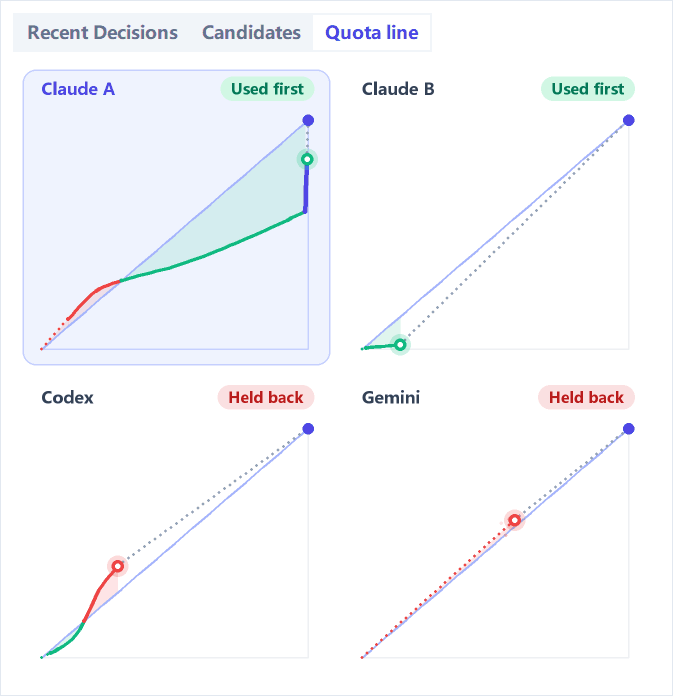

<div align="center">

# 🧭 AgentCompass

**Route sub-agent tasks across your coding subscriptions by what each task needs and what each quota window has left.**

[English](#english) · [简体中文](#简体中文) · [Technical Reference](docs/technical-reference.md) · [`llms.txt`](llms.txt)


</div>

---

## English

### What it is for

If you delegate coding work to sub-agents and pay for more than one subscription, four things are decided by hand on every task:

| Problem | What AgentCompass does |
| :-- | :-- |
| Each subscription has its own limits and reset times: 5-hour and weekly windows, on different clocks. | Reads the current-period usage of every signed-in account from local snapshots and follows each window on its own clock. |
| Quota expires unused on one account while another runs dry. | Spends first the quota that is about to expire, and holds back a window that is being used faster than it recovers. |
| The right model and effort differ from task to task. | A small classifier states what the task needs; every available `model × effort × account` is scored against that need. |
| You do not know what a delegated worker will cost until it has run. | Estimates hours and API-equivalent USD for each candidate before launch and writes the decision to a local ledger. |

It works with plans you already have: Claude Max / Pro, ChatGPT / Codex, Google AI Ultra / Pro, Grok, and OpenAI-compatible pools. When the main session wants to delegate a task or ask for a second opinion, it runs one command:

```bash
agentcompass roll --task "<what the worker should do>"
```

### How a task is routed

1. **Profile.** The classifier returns the task's expected hours and a need level (0–3) on four ability axes: divergence, global rigor, module precision, vision & tools. Single-thread work is handed back to the main session, and a brief that holds several independent tasks is returned to be split.
2. **Candidates.** Every model, effort and account that can start the task now. Per-axis model scores come from cited public sources.
3. **Score.** `N = F − β × X / h`
   - `F`, the fit: the need-weighted average of the model's axis scores, each capped at what the task needs. Ability above the need does not count, so a rename is not sent to the strongest model at maximum effort.
   - `X`: the part of this task's spend, in USD, that lands over the recovery line of the account's quota window (next section). `h` is the task's hours; `β` is that window's exchange rate between over-line dollars and fit. This term is the fifth axis, quota economy.
4. **Ties.** Equal `N` goes to the candidate that uses the under-line quota expiring earliest, then to the one that finishes sooner, then to the cheaper one.
5. **Launch.** The winner starts as a worker, and the ledger keeps every candidate's score.

The animation above is the tray's Decision Compass replaying one decision: the task, its kind, the candidate routes, the top two candidates on the five axes, and the winner. The numbers in both animations are synthetic.

### Quota: the recovery line

Treat a window's quota as recovering evenly over its period. A window with capacity `C` has recovered `C × elapsed / period` so far; that is its recovery line.

- **Usage under the line.** The gap is quota that has recovered and will expire at the reset if nobody spends it. Spending it costs nothing.
- **Usage over the line.** The window is being drained faster than it recovers. Each further dollar is borrowed from the rest of the period and is charged at `β`.

<div align="center">

</div>

The animation replays one 2-hour refactor at two moments. The task needs global rigor and module precision; Opus 5.5 meets the need, so its `F` is 0.667.

**A window ahead of its line is spared.** Five days before Claude A resets, 45% of it is used and its line stands at 29%. Opus 5.5 on Claude A would put $46 over the line: `N = 0.667 − 0.0075 × 46 / 2 = 0.495`. Claude B is under its line, so the same model and the same $46 cost nothing there: `N = 0.667`. The task runs on Claude B.

**Sprint before reset.** Two hours before Claude A resets, 40% of it is left, nearly all of it under the line. Opus 5.5 now scores 0.667 three ways: on Claude A in normal mode (2 h, $46), on Claude A in fast mode (1.3 h, $91), and on Claude B. The tie goes to Claude A, whose quota expires in 2 hours instead of 6 days, and then to fast mode, which finishes 40 minutes sooner. Fast mode wins only because its whole spend stays under the line; with one dollar over, the normal run would rank higher.

**Resets that do not line up.** None of this needs the windows to share a schedule. At that same moment Codex is five days from its reset and ahead of its line, so the $9 for Sol 6.1 are charged (`0.652 − 0.008 × 9 / 2 = 0.616`) while the $91 on Claude A are not.

Three details:

- An account with both a 5-hour and a weekly window is checked against both; the larger over-line amount counts.
- A free starter allowance is a pool that never resets. Nothing recovers, so all of its spend is over the line. It is not treated as unlimited.
- The only usage input is each account's consumption in its current period. There is no usage history and no demand forecast.

### Staying in control

- Name a model or an effort in your prompt and the main session passes it through as `--model ... --effort ... --basis "<your words>"`. The router does not override it.
- `agentcompass plan --input examples/task.json --dry-run` prints the ranking for a task without launching anything or writing to the ledger.
- An optional `PreToolUse` hook blocks sub-agent launches that did not go through the router.
- A worker whose cumulative context reaches 2M tokens is replaced by a new worker with a handoff brief instead of being compacted again.

### Quickstart

**Windows (installer, no Python or admin rights needed):**

Download `AgentCompass-tray-setup.exe` from [Releases](https://github.com/akiiwa-games/AgentCompass/releases) and run it, or install silently from PowerShell:

```powershell
AgentCompass-tray-setup.exe /VERYSILENT /SETUP=hooks      # /SETUP=nohooks to skip the spawn gate
```

**macOS / Linux, or CLI-only (Python 3.11+):**

```bash
uv tool install "git+https://github.com/akiiwa-games/AgentCompass"
agentcompass plan --demo --dry-run                        # offline demo, no credentials needed
agentcompass setup                                        # --dry-run to preview; `agentcompass uninstall` undoes it
agentcompass doctor                                       # check active install and signed-in providers
agentcompass roll --task "<what the worker should do>"    # route and launch a worker
```

Or hand setup to your coding agent:
*"Read this repository. Run `agentcompass setup --dry-run`, show me what it would change, then run it and route this task: …"*

### Supported Hosts & Docs

- **Hosts**: Claude Code, Codex CLI, Google Antigravity (`agy`), Paseo, Pi, OpenCode, Orca, T3 Code, and Herdr core (`hc`).
- **Host & gateway plugins**: [cindy-agentcompass-plugin](https://github.com/akiiwa-games/cindy-agentcompass-plugin) (Cindy tasks), [magpie-agentcompass-router](https://github.com/akiiwa-games/magpie-agentcompass-router) (Magpie gateway), [usage-float](https://github.com/akiiwa-games/usage-float) (floating quota HUD).
- **Reference**: allocation internals, quota collection, the Windows tray console, host rollout, checkout migration and the test suites are in **[`docs/technical-reference.md`](docs/technical-reference.md)**.

---

## 简体中文

### 它解决什么问题

如果你把编码任务派给子 Agent，同时又订阅了不止一家服务，那么每个任务都有四件事要靠人来定：

| 问题 | AgentCompass 的做法 |
| :-- | :-- |
| 每个订阅的限额和重置时间各不相同：5 小时窗口、周窗口，各走各的时钟。 | 从本地快照读取每个已登录账号本期的用量，每个窗口按自己的时钟计算。 |
| 一个账号的额度没用完就作废，另一个账号却已经见底。 | 先花快要作废的额度；消耗速度超过恢复速度的窗口先留着。 |
| 不同任务适合的模型和档位不同。 | 小模型分类器给出任务的需求；每个可用的 `模型 × 档位 × 账号` 都按这份需求打分。 |
| 派出去的 worker 要花多少，跑完才知道。 | 启动前先估算每个候选的工时和按 API 价格折算的 USD，并把这次决策写入本地台账。 |

支持你已经在用的订阅：Claude Max / Pro、ChatGPT / Codex、Google AI Ultra / Pro、Grok，以及 OpenAI 兼容的号池。主会话要派发任务或找顾问时，只运行一条命令：

```bash
agentcompass roll --task "<交给子 Agent 的完整任务>"
```

### 一个任务如何被路由

1. **画像。** 分类器给出任务的预计工时，以及四个能力轴上的需求等级（0–3）：发散创新、全局严密、模块精准、视觉与工具。单线任务交还主会话自己做；一份任务书里有多个独立任务时，退回给主会话拆分。
2. **候选。** 所有现在就能开工的模型、档位与账号组合。各轴的模型分数来自注明出处的公开数据。
3. **打分。** `N = F − β × X / h`
   - `F` 是契合度：模型各轴分数按需求加权平均，每个轴只算到任务需要的高度。超出需求的能力不计分，所以改个名字不会被派给最强的模型开最高档。
   - `X` 是这次花费中越过该账号额度窗口恢复线的部分，单位 USD（见下一节）。`h` 是任务工时，`β` 是该窗口越线花费与契合度之间的汇率。这一项就是第五个轴：额度经济。
4. **平分时。** `N` 相等，先选所用线下额度最早到期的候选，再选完成更快的，最后选更便宜的。
5. **启动。** 胜出的候选作为 worker 启动，台账里保留每个候选的分数。

页首的动画是托盘“决策罗盘”重放一次决策：任务、任务类型、候选路线、前两名在五个轴上的对比、胜出者。两段动画里的数字都是合成数据。

### 额度：恢复线

把一个窗口的额度看成在周期内匀速恢复。容量为 `C` 的窗口，到现在为止已经恢复了 `C × 已过时间 / 周期`，这就是它的恢复线。

- **用量在线下。** 差额是已经恢复、但到重置时没人用就会作废的额度。花掉它不计成本。
- **用量在线上。** 这个窗口的消耗快于恢复。再花的每一美元都是向本期后面借的，按 `β` 计价。

<div align="center">

</div>

动画把同一个 2 小时的重构任务放在两个时刻各重放一次。任务需要全局严密和模块精准；Opus 5.5 满足需求，`F` 为 0.667。

**超前于恢复线的窗口先留着。** 距 Claude A 重置还有五天时，它已经用了 45%，而恢复线只到 29%。在 Claude A 上用 Opus 5.5 会有 $46 越线：`N = 0.667 − 0.0075 × 46 / 2 = 0.495`。Claude B 在线下，同一个模型、同样的 $46 在那里不计成本：`N = 0.667`。任务派到 Claude B。

**重置前狂蹬。** 距 Claude A 重置还有两小时，还剩 40%，几乎全部在线下。这时 Opus 5.5 有三种跑法都是 0.667：Claude A 普通模式（2 小时，$46）、Claude A 快速模式（1.3 小时，$91）、Claude B。平分时先选 Claude A，因为它的额度 2 小时后就到期，而 Claude B 还有 6 天；再选快速模式，因为能早 40 分钟完成。快速模式能胜出，只因为它的整笔花费都在线下；只要有一美元越线，普通模式就会排在前面。

**重置时间不同步。** 以上计算都不要求各窗口的重置时间对齐。在同一时刻，Codex 距重置还有五天且已超前于恢复线，所以 Sol 6.1 的 $9 要计价（`0.652 − 0.008 × 9 / 2 = 0.616`），而 Claude A 上的 $91 不计。

三点补充：

- 同一账号同时有 5 小时窗口和周窗口时，两个窗口各算一次，取越线额较大的那个。
- 免费的入门赠额是一个永不重置的额度池。它不会恢复，所以花的每一美元都算越线。它不会被当作无限额度。
- 用量方面的输入只有每个账号本期的消耗。不看历史用量，也不做需求预测。

### 你始终可以做主

- 在对话里点名模型或档位，主会话会以 `--model ... --effort ... --basis "<你的原话>"` 原样透传，路由器不会改。
- `agentcompass plan --input examples/task.json --dry-run` 只打印某个任务的候选排名，不启动任何 worker，也不写台账。
- 可选的 `PreToolUse` 门禁会拦截没有经过路由器的子 Agent 启动。
- worker 的历史累计上下文达到 2M tokens 时，会带着交接任务书换一个新 worker，而不是继续压缩。

### 快速开始

**Windows（独立安装包，无需管理员权限或预装 Python）：**

从 [Releases](https://github.com/akiiwa-games/AgentCompass/releases) 下载运行 `AgentCompass-tray-setup.exe`，或在终端静默安装：

```powershell
AgentCompass-tray-setup.exe /VERYSILENT /SETUP=hooks      # 不装门禁可用 /SETUP=nohooks
```

**macOS / Linux 或仅安装 CLI（Python 3.11+）：**

```bash
uv tool install "git+https://github.com/akiiwa-games/AgentCompass"
agentcompass plan --demo --dry-run                        # 离线演示，无需登录账号
agentcompass setup                                        # --dry-run 预览改动；agentcompass uninstall 可完整回滚
agentcompass doctor                                       # 查看安装状态与已识别账号
agentcompass roll --task "<交给子 Agent 的完整任务>"       # 自动分类、选型并启动 worker
```

也可以直接把仓库交给你的主 Agent：
*“读一下这个仓库，先跑 `agentcompass setup --dry-run` 给我看会改哪些配置，确认后执行安装并帮我路由这个任务：……”*

### 支持的宿主与技术文档

- **直接支持的宿主**：Claude Code、Codex CLI、Google Antigravity (`agy`)、Paseo、Pi、OpenCode、Orca、T3 Code、Herdr core (`hc`)。
- **配套插件**：[cindy-agentcompass-plugin](https://github.com/akiiwa-games/cindy-agentcompass-plugin)（Cindy 任务路由）、[magpie-agentcompass-router](https://github.com/akiiwa-games/magpie-agentcompass-router)（Magpie 网关路由）、[usage-float](https://github.com/akiiwa-games/usage-float)（桌面额度悬浮窗）。
- **参考文档**：分配实现细节、多账号额度采集、Windows 托盘控制台、各宿主全局规则同步、从源码目录迁移及测试命令，见 **[`docs/technical-reference.md`](docs/technical-reference.md)**。

## License

[MIT](LICENSE) · Copyright (c) 2026 akiiwa-games.
