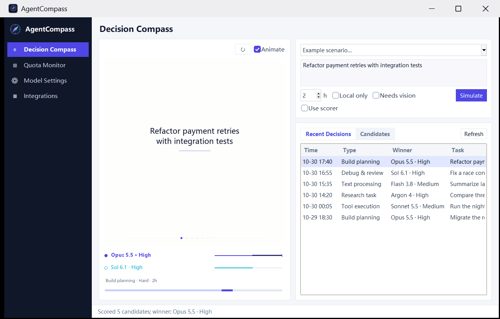
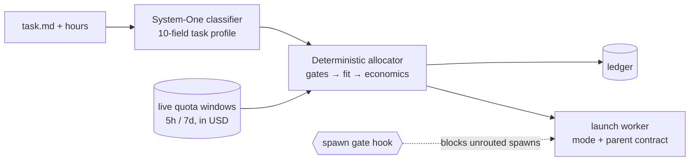

<div align="center">

# 🧭 AgentCompass

**Match each task to the right model, effort and subscription quota. Decided by arithmetic, not habit.**




<sub>The optional Windows cockpit replaying a synthetic decision (illustrative scores, no live account data). The router underneath is a portable Python Agent Skill (<code>SKILL.md</code>) with JSON config · <a href="llms.txt"><code>llms.txt</code></a></sub>

</div>

A deterministic **multi-agent task router and subscription quota scheduler** for the flat-rate plans you already pay for
(Claude Max / Pro, ChatGPT / Codex, Google AI Ultra / Pro, Grok). Unlike per-token prompt routers (RouteLLM, OpenRouter),
it dispatches a **worker per task**: a `model × effort` bundle that clears the ability floor, spends quota that is about
to expire, rotates workers at 2M context tokens, and is enforced by a `PreToolUse` spawn gate.

## Quickstart

```bash
# Offline demo: no credentials, provider CLIs or quota cache needed
python -X utf8 skills/agent-compass/scripts/route_judge.py plan --input examples/task.json --dry-run --demo

# Install the CLI (Python 3.11+), then onboard: detects signed-in CLIs, asks before each step,
# backs up every file it changes, never installs the spawn gate unless you say so
uv tool install "git+https://github.com/akiiwa-games/AgentCompass"     # or: pip install git+https://github.com/akiiwa-games/AgentCompass
agentcompass setup          # --dry-run to preview; `agentcompass uninstall` undoes it
agentcompass doctor         # read-only health report
agentcompass plan --input examples/task.json --dry-run
```

Windows users can instead run the per-user `AgentCompass-tray-setup.exe` from [Releases](https://github.com/akiiwa-games/AgentCompass/releases) (no admin rights). Or hand it to your coding agent:
*"Read this repository. Run `setup/onboard.py --dry-run`, show me what it would change, then run it and route this task: …"*

### One real decision

```text
$ route_judge.py plan --input examples/task.json --dry-run
task      other_or_mixed · routine · 1.5 h · local_only (runs pytest)
winner    argon_high   score 0.2589
          gemini-weekly: 63% left ($158.19), this work ~2.4% (~$6.00),
          other work wants ~48% before its reset in 89h → opportunity cost 0.0211
runner-up sol_high     score 0.2528   (codex: 83% left, but observed demand ~84% before reset in 144h)
excluded  dot          local_only: needs this machine
```

No LLM makes the final call. A lightweight System-One classifier profiles the brief; a deterministic allocator ranks
every signed-in `model × effort` bundle on ability floors, task fit and quota economics; every decision lands in an
auditable, replayable ledger. With nothing signed in or no quota readings, `plan`/`roll` return `no_ready_account` /
a `no_usage_data` warning pointing at `agentcompass setup` instead of guessing.

> **Alpha.** The shipped `accounts.json` is a neutral public catalogue. Personal accounts and scoring policy go in
> `~/.agent-compass/accounts.local.json`; later overrides in `accounts-override.json`. Model-capability files are generated views.

## Why

You pay for frontier subscriptions whose quota windows reset on a fixed clock, yet dispatch agents by feel:

| Vibe dispatching | AgentCompass |
|---|---|
| Every task gets Opus or Astra "to be safe"; the weekly window is gone by Wednesday. | **Minimum-sufficient ability.** Models far above the difficulty floor pay an over-qualification penalty scaled by $/h burn. Chores go to Flash or the free remote Dot worker. |
| Cross-module refactors go to a model that is sharp inside one file but blind across the repo. | **Model DNA fit.** Each model carries `divergence / global_rigor / module_precision`; repo-wide work (`context_scale = 3`) penalizes low-`global_rigor` models. |
| Sunday night, 40% of a weekly window expires unused. | **Pre-reset spend-down.** Within 36 h of a weekly reset, surplus above forecast demand earns up to `+0.20` score. |
| A worker five compactions deep keeps "fixing" code it no longer remembers. | **2M-token rotation guard.** Tracks `compacted + live` context over the worker's whole history; at 2M, new turns are blocked and a fresh worker gets a handoff brief. |
| The main agent spawns sub-agents however it likes. | **Spawn gate.** A `PreToolUse` / `tool_call` hook rejects any launch (Claude's built-in Explore included) without a router ledger entry from the last 15 minutes or without a real parent session address. |

## What's new

| Area | What you get |
|---|---|
| **Hosts** | Claude Code, Codex CLI, Google Antigravity (`agy`), Paseo, Pi, OpenCode, plus the orchestrators **Orca** (`orca orchestration worker-start`, per-account Codex homes synced automatically) and **T3 Code** (`delegate_task`, detected from `T3_MCP_URL`). |
| **Plan templates** | [`plan-templates.json`](skills/agent-compass/references/plan-templates.json) ships calibrated capacity and burn rates: Claude `Pro` / `Max 5x` / `Max 20x`, ChatGPT / Codex `Plus` / `Team` / `Pro 100` / `Pro`, Google AI `Pro` / `Ultra 5x` / `Ultra 20x`. Aliases resolve, missing fields are filled without overriding your values, and a configured plan seeds capacity when no probe result exists. |
| **Install** | `agentcompass setup / doctor / plan / roll / providers / uninstall` via `uv tool install`, or the per-user Windows tray installer. |
| **Smarter gate** | Blocks unrouted spawns, rotates workers at 2M historical context, and blocks launches on disabled accounts or tiers. A parent can still steer, wrap up or hand off its own **running** worker; completion notifications are guaranteed so workers without a messaging tool (e.g. `agy`) never lose their result. |
| **Cockpit** | 5-axis decision console, ledger replay, dry-run simulator, three-tab model settings, background CLI auto-update that never interrupts live sessions. |
| **usage-float** | Live quota HUD plus one-click redemption of official rate-limit reset credits (Claude 7d / 5h, ChatGPT / Codex). See [usage-float](https://github.com/akiiwa-games/usage-float). |

## How it decides



```text
score = harness_factor × (w_fit·fit + w_ability·ability) + w_continuity·continuity
      + reset_bonus + free_usage + boost + quality_bonus
      − opportunity_cost − effort_penalty − overqualification

fit              = w_route·route_fit + w_capability·capability_fit + w_subjective·model_dna_fit
expected_usd     = usd_per_hour × hours × burn / 0.70
opportunity_cost = sum over windows of displaced_usd × score_per_displaced_usd (0.012)
```

Hard gates run first: sign-in and credential health, host policy, modality (text-only models never get visual work),
`local_only`, ability floor by difficulty, and per-window safety reserves net of in-flight work. A bundle that draws
several pools must clear every window; the costs add and the dearest window binds. One score point is about `$83` of
displaced subscription USD. Same model on a different harness keeps its value unless `harness_factor` says otherwise
(Codex vs Pi is a sibling-only `0.03` step). Public defaults give subjective ratings zero weight; unknown capacity stays unknown.
Weights and capability priors live in [`accounts.json`](skills/agent-compass/references/accounts.json).

**Versus prompt routers.** RouteLLM, OpenRouter Auto and Not Diamond pick a model *per prompt* and bill *per token*.
AgentCompass picks a *worker per task* and manages flat-rate windows that *expire*. Different layers; they combine.

| Layer | What it is | Required? |
|---|---|---|
| **Core**: [`skills/agent-compass`](skills/agent-compass/SKILL.md) | Classifier, allocator, ledger, and `roll` (`classify → allocate → launch` with explicit permission mode and parent-session contract). Python 3.11+, Windows-first, POSIX-compatible. | **Yes** |
| **Gate**: [`setup/router_gate_hook.py`](setup/router_gate_hook.py) | Spawn gate and 2M rotation guard for every host with pre-tool hooks. | Opt-in |
| **Cockpit**: [`tray/`](tray/) | Windows tray, decision compass, quota HUD and local bridges ([`gemini-web`](https://github.com/akiiwa-games/gemini-web), `codex-chatgpt-web`, `dot2api`, `easytier`). | Optional |

<details>
<summary><b>Install details: packaging, upgrades, ports, Paseo bridge</b></summary>

- The router is a Python package, not a frozen executable: skills stay real directories because Claude, Codex and Antigravity read `SKILL.md`, and `route_judge.py` loads sibling scripts by path (`python -I`).
- A packaged install (no `.git`) checks [GitHub Releases](https://github.com/akiiwa-games/AgentCompass/releases) and tells you to run `uv tool upgrade agentcompass`; a development checkout fast-forwards with git. `ROUTE_MANAGER_GITHUB_ORG` and `ROUTE_MANAGER_USAGE_FLOAT_REPO` override the org and the usage-float clone URL.
- Tray extras: `pip install "agentcompass[tray]"`. `packaging/build.ps1` builds a one-folder PyInstaller tray and, with Inno Setup 6, a per-user installer (`PrivilegesRequired=lowest`) that registers the "Route Manager" scheduled task; uninstall removes the task, the `PRO_CONSULT_*` / `CODEX_WEB_GPT_EXTERNAL_TRAY` variables and the Startup shortcuts. Builds are unsigned unless `AGENTCOMPASS_SIGNTOOL` and a certificate are set (SmartScreen will warn; see `packaging/SIGNING.md`). Tagged pushes (`v*`) attach the wheel and installer to a Release.
- Loopback ports default to Dot2API 8788, ChatGPT Web 17843, Gemini Web 17849, account login 17851, EasyTier 15888, Muse2API 18610. `AGENTCOMPASS_PORT_*` overrides `~/.agent-compass/ports.json`, which overrides the defaults; `doctor` reports conflicts.
- Paseo dispatch via `roll` needs Node.js: `npm --prefix setup/paseo-bridge ci` (the host rollout script does this when it detects Paseo).
- The demo uses a fixed synthetic quota snapshot and reference fleet, makes no network calls, writes no ledger and launches nothing. Add `--format json` for the full breakdown.

</details>

## Repository Layout

Companion repositories and runtime directories are separate local checkouts or ignored host state, not bundled here.

| Path | Description |
|---|---|
| `skills/` | Agent skills (`agent-compass`, `dot-subagent`, `chatgpt-pro-consult`, `gemini-web`), loaded at the system level on every host via junctions in `~/.codex/skills`, `~/.claude/skills` (`~/.claude-*/skills`), `~/.pi/agent/skills`, `~/.gemini/config/skills.json` and materialized directories in `~/.gemini/skills`. |
| `tray/` | Windows cockpit and service supervisor: tray (`app.pyw`), decision console (`router_window.py`, `router_data.py`, `radar_chart.py`, `ui_theme.py`), plugin registry, service lifecycle, updater, headless quota collector (`usage_collector.py`) and capacity analytics. |
| `audit/` | `router_audit.py`: read-only daily check of sub-agent launches against `~/.agent-compass/router-ledger.jsonl`. |
| `setup/` | Onboarding (`onboard.py`), host sync (`sync_host_globals.py`, `host_rules.py`), spawn gate (`router_gate_hook.py`), Dot2API and Pi helpers, `claude2_config.py`. |
| `usage-float/`, `gemini-web/`, `dot2api/`, `codex-chatgpt-web/`, `easytier/`, `tools/bun/` | Companion checkouts and runtime state; see [usage-float](https://github.com/akiiwa-games/usage-float#readme) and [gemini-web](https://github.com/akiiwa-games/gemini-web#readme). |

---

## Dynamic Provider Inventory & Quota Discovery

AgentCompass discovers local account availability on every allocation through
[`skills/agent-compass/scripts/provider_inventory.py`](skills/agent-compass/scripts/provider_inventory.py) without making network calls:

- **Multi-Source Local Discovery**: Inspects native CLI sign-ins (`~/.claude`, `~/.claude-*`, `~/.codex`, `~/.codex-*`, `~/.grok`, `agy`), Paseo provider bindings (`~/.paseo/config.json`), CC Switch SQLite provider/health records, and Magpie gateway configurations (`usage-float.json` / `settings.json`).
- **Automatic Pause & Resume**: Disabled or removed accounts, rejected credentials, or plugins turned off in the cockpit (`status=paused`, `reason=plugin_disabled_in_agentcompass`) are excluded automatically on the next allocation and resume as soon as credentials or plugins are restored.
- **Deduplicated Quota Owners**: Duplicate launchers or aliases pointing to the same underlying subscription share a single quota owner so concurrent tasks never double-count remaining allowance.

Inspect the live inventory at any time:

```bash
python -X utf8 skills/agent-compass/scripts/route_judge.py providers
```

### Direct Subscription Quota Collection (`usage-float` + `usage_collector.py`)

Quota windows are collected directly by [`usage-float/usage_float.py`](https://github.com/akiiwa-games/usage-float/blob/main/usage_float.py) and scheduled headlessly by [`tray/usage_collector.py`](tray/usage_collector.py) every 5 minutes into `~/.usage-float/usage-cache.json` (with a diagnostic receipt at `~/.agent-compass/usage-collector.json`):

- **Dynamic Multi-Account Discovery**: Automatically detects primary and conventional additional Claude/Codex homes (`~/.claude`, `~/.claude-*`, `~/.codex`, `~/.codex-*`), arbitrary named Paseo accounts with configured homes, and remote Magpie gateways (`magpie_usage.py`). Account family and launcher settings determine behavior.
- **Activity-Aware Polling Cadence**: Active accounts poll roughly every 5 minutes, idle accounts every 30 minutes, and accounts with unknown/stale activity every 15 minutes. Failed probes respect the same cadence and per-credential `429` backoff.
- **Read-Only Credential Safety**: The collector never rotates or overwrites CLI OAuth tokens. Token refresh is left strictly to the owning CLI (`claude`, `codex`, `agy`). Snapshots are bound to a one-way SHA-256 fingerprint of their credential source and updated via cross-process file locks and atomic file replacement.

### Adding an isolated Claude account

The account's Paseo provider extends Claude Code with both `CLAUDE_CONFIG_DIR` and `CLAUDE_SECURESTORAGE_CONFIG_DIR` set to its signed-in home. Keep both paths identical: an empty secure-storage path can select the primary account's credentials.

After signing in to the isolated home:
1. Close the Usage Float window (so its shutdown does not overwrite `config.json`).
2. Run `python setup/claude2_config.py --account team-backup --home <signed-in-home> --label 'Team backup'`. The script backs up existing settings, registers the named Paseo provider, enables that account's `7d` and `5h` Usage Float rows, and adds its projects directory to capacity analytics. The historical filename and no-argument `claude-2` default remain compatibility shortcuts.
3. Run `paseo reload` and reopen Usage Float.

---

## The Windows Cockpit (`tray/`)

### System Tray Menu

The tray menu is at most two levels deep and performs zero blocking I/O or network probes when opened:

1. **Open AgentCompass** (default action on left-click) — opens the main decision and management panel.
2. **Pre-Reset Priority** — quick submenu to boost a subscription whose weekly quota is about to reset.
3. **One single-click entry per enabled window plugin**:
   - `Usage Float: …` — shows the floating HUD or auxiliary-screen panel.
   - `ChatGPT Web: …` — opens the ChatGPT Web launcher window.
   - `Gemini Web: …` — starts the dedicated Chrome profile and brings a Gemini / AI Studio tab to the front.
   - `EasyTier: …` — opens the mesh LAN status window.
4. **Exit** — closes the tray icon while leaving background bridges and services running (`app.pyw --attach-only` reconnects without starting paused services).

The tray icon displays a status dot: **green** when core usage collection and all enabled always-on plugins are healthy, **amber** while a pre-reset priority boost is active, and **red** when an enabled service has stopped.

### Main Panel Tabs (`tray/router_window.py`)

`router_window.py` runs in its own `pythonw` process so closing the window releases all UI memory immediately:

- **5-Axis Scoring & Decision Console**:
  - **Dry-Run Simulator**: Test any task description or preset with custom hours, `local_only`, and `needs_visual` flags using `allocator.plan` without writing to the ledger.
  - **Ledger Replay**: Browse the last 30 router decisions and click any entry to replay its historical parameters against current live quota windows.
  - **Dual-Mode 5-Axis Radar Chart**: Switch between **Decision Score (5D)** (comparing the winning candidate against the runner-up across subjective fit, capability fit, route fit, net ability, and quota economy) and **Model DNA (5D)** (comparing any two models across divergence, global rigor, module precision, reasoning/anti-hallucination, and visual/GUI capability). Hovering any vertex displays the exact formula and raw values.
- **Account Quotas & In-Flight Tasks**:
  - Live status badges (`Ready`, `Paused`, `Plugin Disabled`, `Blocked by Host Policy`), remaining percentage and API-equivalent USD per window, 3h/24h burn rates, reset countdowns, one-click quota refresh, and active worker sessions with their cumulative uncompressed context against the 2M-token rotation limit.
- **Model Settings** — three tabs: **Models & Boost**, **Scoring & DNA**, and **System Options**.
  - The home page shows discovered harness/account combinations, selected model chips and a model picker with select-all, invert and clear. Model discovery runs in the background through registered `paseo_provider`, `openai_compatible` or `static` probes. Discovered chat models become selectable bundles scored from their default profile (subscription pools on by default, metered proxies off); models the router cannot run are not listed. The account directory icon edits one shared, case-insensitive `cwd_regex`; legacy `allowed_cwd` prefixes remain readable. Preferences are sparse overrides with backups under `~/.agent-compass/backups/`.
  - Temporary priorities remain on the home page. Scoring weights and model DNA share one save action on the second tab.
  - **CLI updates** live in the home toolbar: **Update** checks and updates supported installs in the background, and **Auto-update daily** enables daily maintenance. Active CLI sessions defer their install's update and are never stopped. Provider environments select the same installation and npm prefix the router launches. Unknown/manual installs receive no guessed installer; Grok Bot's pinned build stays on Integrations. The CLI log opens from System Options.
- **Plugins & Services**:
  - Individual cards for every service and plugin with `Enabled` and `Autostart` toggles, health status, and service-specific controls.

### Services & Optional Plugins

State is stored atomically in `~/.agent-compass/plugins.json`:

| Service / Plugin | Window in Tray Menu | Autostarts by Default | Description |
|---|---|---|---|
| **Usage Collector & Capacity Stats** (`core`) | No (background) | Always on | Runs `tray/usage_collector.py` and `tray/capacity_stats.py --once` every 5 minutes, writing `~/.usage-float/usage-cache.json` and `~/.agent-compass/capacity.json`. |
| `usage-float` | Yes | Yes | Borderless subscription quota HUD and live wallpaper switcher (`usage-float/`). |
| `chatgpt-web` | Yes | Yes | Local ChatGPT Web bridge (`127.0.0.1:17843`) run from `codex-chatgpt-web/` with anchored patches from `tray/chatgpt_web_patch.py`. |
| `gemini-web` | Yes | No (on demand) | Dedicated Google Chrome profile with loopback CDP (`127.0.0.1:17849`) for Gemini, AI Studio, Flow, and Omni 1.1 video generation. |
| `easytier` | Yes | Yes | Per-host mesh VPN supervisor running `easytier-core.exe` (`127.0.0.1:15888` RPC portal) via a SYSTEM scheduled task. |
| `dot2api` | No (background) | Yes | Local Dot2API server (`127.0.0.1:8788`) exposed via a Cloudflared quick tunnel; `tray/dot_reconnect.py` automatically registers new tunnel URLs in ChatGPT and prunes stale plugin entries. |
| `muse2api` *(opt-in)* | No (background) | Once enabled | Clones `www222fff/muse2api` (`127.0.0.1:18610`, data in `~/.muse2api/data`) for headless Chrome muse.ai chat, image, and video generation. |

**Sign in & import** on the Muse2API card (`tray/account_login.py`) adds an account without DevTools or a browser extension. It opens installed Chrome on its own profile (`%LOCALAPPDATA%\AgentCompass Account Login\chrome-profile`, loopback CDP `127.0.0.1:17851`), waits up to 10 minutes for `hatch_sess` and `hatch_native_auth_device` on muse.ai, reads them over CDP, posts them to `/admin/accounts` (refreshing the existing account when the session is already imported), and closes the window. Cookies are never written to disk by the shell.

### Temporary Pre-Reset Priority

Selecting a model in the **Pre-Reset Priority** submenu applies a `+0.35` score boost to that subscription's weekly window for up to 24 hours (`~/.agent-compass/router-overrides.json`):
- Requires a fresh usage reading no older than 15 minutes and remaining weekly quota above `safety_margin_pct` (`5%`).
- Once the weekly window resets, the allocator latches `reset_confirmed_at` and retires the boost automatically, displaying a `Reset Confirmed` badge for 12 hours.

### EasyTier Mesh Setup

The tray remains unprivileged while `Route Manager EasyTier` runs as a `SYSTEM` scheduled task (`SDDL GRGX` grants the interactive user only read/start/stop permissions on that task, while `easytier/bin/`, `private/`, `logs/`, and `state/` are writable only by `SYSTEM` and `Administrators`):

```powershell
python tray\easytier_setup.py check
python tray\easytier_setup.py install --binaries DIR --config THIS_HOSTS_TOML [--hook pre-start.ps1] [--legacy legacy.json] [--switch --expect-peer HOSTNAME]
python tray\easytier_setup.py switch|recover|rollback --expect-peer HOSTNAME
python tray\easytier_setup.py arm-recovery --expect-peer HOSTNAME --minutes 10
python tray\easytier_setup.py detach-switch --expect-peer HOSTNAME
python tray\easytier_setup.py cleanup
python tray\easytier_setup.py uninstall
```

### Host Rollout & System-Level Skill Loading (`setup/sync_host_globals.py`)

When landing AgentCompass on a machine, **system-level skill loading is mandatory** so every coding agent session discovers `agent-compass` (and `dot-subagent`, `chatgpt-pro-consult`, `gemini-web`) regardless of the active workspace directory:

```powershell
# Synchronize system-level skills and global rules (AGENTS.md / CLAUDE.md / GEMINI.md / Paseo prompt)
python -X utf8 setup\sync_host_globals.py

# Also install (or keep refreshing) the PreToolUse / tool_call spawn gate
python -X utf8 setup\sync_host_globals.py --hooks

# Preview only, or undo everything this setup recorded
python -X utf8 setup\sync_host_globals.py --dry-run
python -X utf8 setup\sync_host_globals.py --uninstall

# The same command normalizes ~/.gemini/config/skills.json to absolute POSIX paths.
```

Safety properties of the sync (`setup/onboard.py` runs the same code):

- **Your text is never replaced.** Rules go into a block between `<!-- agentcompass:begin -->` and `<!-- agentcompass:end -->`; anything outside it is kept. A file that is exactly an earlier generated copy is treated as wholly managed.
- **The shipped rules are a neutral English default** (`setup/host_rules.py`). To use your own wording, put `shared.md` (Claude, Pi, Gemini, OpenCode), `codex.md` and `daemon-append.md` (Paseo `appendSystemPrompt`) into `~/.agent-compass/host-rules/`; they are used verbatim, with `@@ROUTE_JUDGE@@`, `@@ROUTER_HOOK_SCRIPT@@` and `@@HOME_POSIX@@` filled in.
- **Every run that changes a file backs it up first** into `~/.agent-compass/backups/host-setup-<timestamp>/`, and records the change in `~/.agent-compass/setup-manifest.json`, which `--uninstall` / `onboard.py uninstall` reads to remove the blocks, hook entries, junctions and Paseo prompt again.
- **The spawn gate is opt-in** (`--hooks`). It blocks every sub-agent launch, including Claude Code's built-in Explore agent, unless `route_judge.py roll` recorded a routing decision in the last 15 minutes. Installations that already have the hook keep it up to date automatically.
- Harness directories (`~/.pi`, `~/.gemini`, `~/.config/opencode`, ...) are only written when that harness is installed.

**System-level skill loading requirements by host harness:**
1. **OpenAI Codex (`~/.codex/skills/<name>`)**: Linked as directory junctions to `<repo>/skills/<name>`, with global delegation rules in `~/.codex/AGENTS.md` (and `~/.codex-*/AGENTS.md`).
2. **Claude Code (`~/.claude/skills/<name>` & `~/.claude-*/skills`)**: Linked via directory junctions to `~/.codex/skills/<name>`, with global rules in `~/.claude/CLAUDE.md` (and `~/.claude-*/CLAUDE.md`).
3. **Google Antigravity (`agy` / Gemini CLI)**:
   - Global skill roots must be registered as **absolute paths** in `~/.gemini/config/skills.json` (`~/.codex/skills`, `~/.agents/skills`, `~/.claude/skills`).
   - Because Antigravity's Go `os.ReadDir` 1-level scanner skips top-level Windows directory junctions (`ReparsePoint`), any junctioned skill in `~/.codex/skills` **must also be materialized as a real top-level directory** in `~/.gemini/skills/<name>` containing a real `SKILL.md` file and live directory junctions for `scripts/` and `references/` (automated by `setup/sync_host_globals.py`).
   - Global delegation rules must be synced to `~/.gemini/GEMINI.md` and `~/.gemini/config/GEMINI.md`.
4. **Pi (`~/.pi/agent/skills/<name>`) & OpenCode**: Populated with skill junctions and global `AGENTS.md` rules (`~/.pi/agent/AGENTS.md`, `~/.config/opencode/AGENTS.md`).
5. **Orca & T3 Code (orchestrator apps)**: Both run the real Claude Code / Codex CLIs on your own `~/.claude` and `~/.codex`, so those rules and skills already reach their agents. Orca additionally keeps a private Codex home per signed-in account (`<Orca userData>/codex-accounts/<id>/home`) and mirrors only `config.toml` into it, so `setup` writes the rules block and links the `agent-compass` skill there too. `roll` recognises an Orca session (`ORCA_AGENT_SESSION_ID` / `ORCA_TERMINAL_HANDLE`) and a T3 thread (`T3_MCP_URL` + `T3_MCP_BEARER_TOKEN`, or `--parent-host t3`) and returns the host's own launch command (`orca orchestration worker-start ...` / the T3 `delegate_task` MCP tool) instead of starting a CLI worker that could not report back. The gate hook blocks both launch paths without a router record.
6. **Paseo Daemon (`~/.paseo/config.json`)**: `daemon.appendSystemPrompt` must be updated via `setup/sync_host_globals.py` so Paseo-spawned sessions inherit the routing and worker communication contract.

### Deployment & Updates

```powershell
python tray\deploy.py check      # Inspect current installation state
python tray\deploy.py install    # Apply ChatGPT Web patches, build launcher, register logon scheduled task
python tray\deploy.py restart    # Restart the tray UI without stopping background services
python tray\deploy.py all        # Install and restart
python tray\updates.py check     # Check how many commits each managed repo is behind upstream
python tray\updates.py update    # Fast-forward pull, rebuild, and restart enabled components with rollback on failure
```

---

## Tests

Tests for optional private host-handover tooling skip when that tooling is absent from a clean clone.

```powershell
# Router core & allocator unit tests
python -m unittest discover -s skills/agent-compass/scripts -p "test_*.py"

# Spawn gate & host setup unit tests
python -m unittest discover -s setup -p "test_*.py"

# Remote Dot sub-agent unit tests
python -m unittest discover -s skills/dot-subagent/scripts -p "test_*.py"

# Windows cockpit & service unit tests
python -m unittest discover -s tray -p "test_*.py"

# Daily router audit unit tests
python -m unittest discover -s audit -p "test_*.py"
```

## Related Projects

- [usage-float](https://github.com/akiiwa-games/usage-float) — standalone Windows subscription quota HUD and collector.
- [lark-mbti-jev](https://github.com/akiiwa-games/lark-mbti-jev) — local Feishu/Lark MBTI and anime persona overlay powered by Jev.

## License

[MIT](LICENSE) · Copyright (c) 2026 akiiwa-games.
