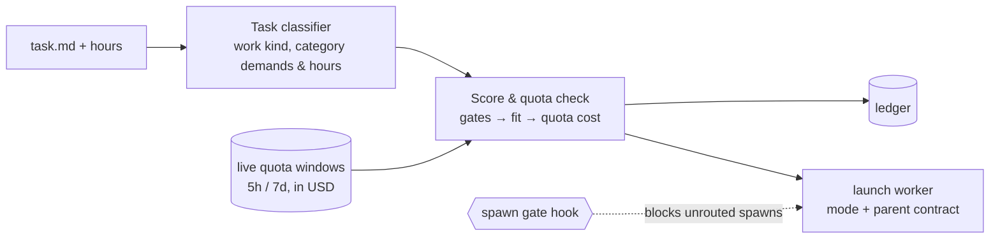

# AgentCompass Technical Reference & Operations Guide

Back to [README.md](../README.md).

## Contents

1. [How Scoring & Allocation Work](#1-how-scoring--allocation-work)
2. [After an Update & Moving from a Git Checkout](#2-after-an-update--moving-from-a-git-checkout)
3. [Packaging, Incremental Updates & Runtime Ports](#3-packaging-incremental-updates--runtime-ports)
4. [Repository Layout](#4-repository-layout)
5. [Provider Inventory & Quota Collection](#5-provider-inventory--quota-collection)
6. [Windows Tray & Decision Console (`tray/`)](#6-windows-tray--decision-console-tray)
7. [Host Rollout & System-Level Skill Loading (`setup/`)](#7-host-rollout--system-level-skill-loading-setup)
8. [Deployment & Tests](#8-deployment--tests)

---

## 1. How Scoring & Allocation Work



```text
fit        = sum_a w_a * (min(z_a, c_a) - t1_a) / sum_a w_a   (in panel standard deviations; zero point t1_a = panel weakest)
targets    = t1: panel minimum, t2: panel median, t3: anchor (claude-opus-5-5 at High = 0.0)
cap c_a    = t_a at demand levels 1 and 2; ceiling_a at level 3 (the highest measured or interpolated High value of any
             catalogued model, never an estimate, converted or manual value)
continuity = max positive (t3 - t2) among highest-demand categories when coupling == "high", else 0
score N    = fit + continuity + boost - quota_cost
```

The classifier states how much the task needs (0–3) of `divergence`, `coding`, `aesthetics` and `tool_operation` (`tool_operation`
level 1 imposes no ability requirement; level 2 evaluates per-effort `responsiveness`; level 3 evaluates
`min(responsiveness, image_recognition)` and requires image input; it applies the cap per facet). A task the classifier marks `needs_visual` or `needs_gui` requires image input at every level: a model whose public data says it takes none leaves the task, and one with no cited modality leaves automatic routing. Routine levels pay nothing
for ability above their target; a level-3 demand keeps crediting ability up to the category's ceiling, so the hardest tasks
can prefer a model measured above the anchor. `t3` stays the anchor: the origin of `z`, level 3 of the manual 1–3 scale and the
upper end of `continuity`. A model's category scores are panel standard scores (`z`)
from public cited boards; a facet a model lacks is estimated from its same-series sibling or its `arena.ai` Overall tier fit (see
[`calibration/README.md`](../skills/agent-compass/calibration/README.md)). `quota_cost` is the quota economy: the part of the
task's spend that lands over the recovery line of the account's quota window, priced in panel-SD score units. The window's
price comes from a value ladder built over the demand grid `quota_economy.FIVE_AXIS_DEMAND_GRID` (levels 0–3 on the thinking
categories), and its level-3 points read the fit with the ceiling as cap. So a model that raises a ceiling moves quota prices
for every task, at every demand level, not only for level-3 tasks. Measured on the test fixtures when the ceilings were
introduced (2026-11-13), the fit unchanged in both cases: the Claude window priced at 0.02511 before and 0.01043 after
(`Fleet` fixture, Claude and Codex 60% used), and ChatGPT Web's cadence pool for a level-1 divergence task with 0 of 5 seats
used and 9 h to reset priced at 0.003385 before and 0.006497 after (cost 0.0049 → 0.0097). Equal net scores
`N` go to the candidate that starts sooner (shorter wait before reset), then finishes sooner, then spends fewer list-price USD,
then has the higher demand-weighted category level and preferred harness (`candidate_ranking.five_axis_order`). Expiring quota is
not a tie-break: under-line allowance already lowers `quota_cost`.

Hard gates run first: sign-in and credential health, host policy, modality (text-only models never get visual work),
`local_only`, a demanded category with no data, and per-window safety reserves net of in-flight work. A bundle that draws from
several pools must clear every window; the tightest window binds. The same model on a different harness keeps its score
(Codex vs Pi is only a tie-break step for read-heavy vs. edit-heavy work). Unknown capacity stays unknown: the account stays
out of automatic routing until public data has it.
A metered USD account is not one of those resetting windows. The account, the spend reading, the balance, and the leftover-field cleanup are defined in [Metered USD](#metered-usd).
Panel membership is derived from the rule above, never a hand list. Adding a non-panel model moves no panel score and no
target (it can raise a ceiling). A change of members moves `sd_panel`, `t1` and `t2`, and with them the level-2 cap and the
exchange rate between ability and quota cost, so `agentcompass data refresh` (and `five_axis.py`) compares the panel it computed
with the shipped `five-axis-scores.json`: when the members differ it prints the added and removed models and, per category and
facet, the old and new `sd_panel`, `t1`, `t2` and ceiling, then exits 3 (refused) and writes nothing unless `--accept-panel-change` is
passed. An accepted change is recorded in `anchor.panel_change` (date, added, removed, shifts) and carried forward until the next.
Category scores live in [`skills/agent-compass/references/five-axis-scores.json`](../skills/agent-compass/references/five-axis-scores.json),
and plan window structure in [`skills/agent-compass/references/plan-templates.json`](../skills/agent-compass/references/plan-templates.json).

| Layer | What it is | Required? |
|---|---|---|
| **Core**: [`skills/agent-compass`](../skills/agent-compass/SKILL.md) | Classifier, allocator, ledger, and `roll` (`classify → allocate → launch` with explicit permission mode and parent-session contract). Python 3.11+, Windows-first, POSIX-compatible. | **Yes** |
| **Gate**: [`setup/router_gate_hook.py`](../setup/router_gate_hook.py) | Pre-tool spawn gate and configured context rotation threshold (`rotate_after_carried_tokens`, set in the tray) check for hosts with pre-tool hooks. | Opt-in |
| **Tray**: [`tray/`](../tray/) | Windows system tray, decision console, quota view, and local bridges ([`gemini-web`](https://github.com/akiiwa-games/gemini-web), `codex-chatgpt-web`, `dot2api`, `easytier`). | Optional |

---

## 2. After an Update & Moving from a Git Checkout

### After an update

AgentCompass does not carry compatibility readers or silent migrations for older local state shapes. If a schema, setting, hook, rule block, or cache under `~/.agent-compass` predates an update, routing fails fast naming the file and its fix. Run:

```powershell
agentcompass doctor
```

`doctor` inspects local state read-only (`accounts-override.json`, `host-policy.json`, `host-rules/*.md`, `user-scores.json`, `router-ledger.jsonl`, `dispatch.sqlite3`, `router-overrides.json`, caches, installed hooks, skill links, and global rule blocks) without modifying user files and prints one of three fixes per flagged path:

1. **Re-run `agentcompass setup`** (`agentcompass setup --yes --hooks`) — refreshes global rule blocks, skill links, and `PreToolUse` / `tool_call` hooks.
2. **Re-toggle in the tray** — rewrites user preference files (`accounts-override.json`, `host-policy.json`, `user-scores.json`, `router-overrides.json`, plugin autostart) in the current schema.
3. **Delete a named cache or state file** — clears stale derived caches (`provider-inventory.json`, `usage-activity.json`, `dispatch.sqlite3`, `~/.usage-float/usage-cache.json`, `~/.cache/agentcompass-calibration` without `fetch-manifest.json`, or old custom `host-rules/*.md` overlays) so the next run recreates them cleanly. Old-shape rows in `router-ledger.jsonl` are skipped during replay, audit, and tray display with a count note; delete `router-ledger.jsonl` when you want a clean ledger.

Leftover fields on a dollar account do not fail the file. The check, the doctor text, and the setup cleanup are defined in [Metered USD](#metered-usd).

### Metered USD

A dollar account is an `accounts-override.json` entry with `billing: metered`, a non-empty `endpoint`, a non-empty `api_key`, and an optional `budget_usd` greater than 0. A metered account without an endpoint is not this account. Subscription windows are not this account.

A Claude or Codex harness that has both a base URL and an API key, and whose base is not `https://api.anthropic.com` or `https://api.openai.com`, is a candidate dollar account. Discovery stays on the local files. Each usage poll reads that key again from the harness configuration. The key is not written to `accounts-override.json`, the usage cache, or any other file. Those two official hosts are not probed. An explicit Magpie gateway (`usage-float.json` with `source: magpie`, or a usage-cache row whose `backend_kind` is `gateway`) is not a candidate. A Claude harness with `ANTHROPIC_AUTH_TOKEN` on a non-official HTTPS base is a live subscription source until a usage probe records that credential as not Magpie; it is not a candidate, and the usage poll keeps reading its subscription windows. After that record, the harness is a candidate. `ANTHROPIC_API_KEY` alone on a custom base stays a candidate. One harness whose Codex config is not valid UTF-8 is skipped; the other harnesses and the handwritten dollar accounts are still read. A handwritten dollar account with the same provider id is the account that is read. The same origin and the same key are one account, and the handwritten entry wins; its endpoint, key, and budget are the ones read. A different key at that origin is a separate account and shows its own spend.

Spend is read only from `GET {origin}/key/info`. The request does not follow a redirect, so the key is not sent to another origin or another path. No completion request is sent. A 200 with a spend number displays `已用 $X`, or `已用 $X / $Y` when `max_budget` is present. That reading is stored for the key and base that were sent. If either has changed when the reading is stored, the reading is discarded and the new key does not inherit it. The stored spend is what changes a candidate's billing from `unknown` to `metered`. Category evidence stays with that same key and base, and the amount follows the latest read (类别证据保留、金额按最近一次读取). A later 401 or 403 shows no number, and the hover says there is no permission to query usage, the same display as an account that has not succeeded. It does not keep the previous dollars on screen. A later timeout, network error, redirect, or other ordinary read failure is a read failure or a stale reading under the existing cache rules. It is not a new success and it does not reset the failure count. That category evidence is dropped only when the key or base changes. On a candidate, a 401 or 403 does not by itself make billing `metered` when no spend has been stored. For an `accounts-override.json` dollar account, a miss with no stored category evidence is an ordinary read failure and the hover names that reason. For a candidate with no stored spend, a 404, a timeout, or any other miss leaves billing `unknown` and shows no number. Routing adds no rule for a missing amount: that stays the existing data gap.

With a budget, the in-memory fleet has `windows.balance` (no `hours`) and `capacity_usd.balance`. Remaining is budget minus spent. The existing starter safety margin excludes the account when that remaining is inside the margin. The balance does not reset (`resets_at` is null, `reset_in_hours` is null). A window whose `hours` is absent never moves its recovery clock (`elapsed_frac` stays 0). With no budget there is no window, the account is not excluded for exhaustion, and it stays a metered last resort (`quota_pools.metered_usd_uncapped`).

Old meter fields on that account (`windows`, `capacity_usd`, `burn_pct_per_worker_hour`, `burn_basis`, `budget_duration`, `timezone`, a nested `litellm` object, or `backend_kind` of `litellm` / `proxy` / `api-proxy`) are not read and do not fail the rest of the file. `doctor` names the account. `agentcompass setup` removes the fields and does not change the account's on/off switch. A top-level `litellm_proxies` section, and the usage-config or Usage Float keys `llm_proxy_timezone`, `llm_proxy_budget_duration`, `llm_proxy_api_key`, `llm_proxy_endpoint`, `llm_proxy_provider_id`, and `litellm_proxies`, are named the same way. Setup removes them. Saving Usage Float settings once removes them from that file.

### Moving from a Git Checkout to the Installed Product

A machine switching from a git checkout to the installed product keeps plugins under `~/.agent-compass/plugins/<id>` and the EasyTier node under `%ProgramData%\AgentCompass\easytier`:

```powershell
# 1. Quit the checkout tray, run AgentCompass-tray-setup.exe from Releases, then re-run setup with the installer's exe.
#    Setup replaces hook, skill and rule entries that pointed at the checkout or a wheel.
& "$env:LOCALAPPDATA\AgentCompass\cli\agentcompass.exe" setup --yes --hooks

# 2. Install or re-register the EasyTier node in %ProgramData%\AgentCompass\easytier (asks for administrator rights through UAC).
python -X utf8 "$env:LOCALAPPDATA\AgentCompass\app\current\tray\easytier_setup.py" install --binaries DIR --config THIS_HOSTS_TOML

# 3. Remove a leftover wheel so it cannot shadow the installer's exe on PATH (`agentcompass doctor` prints the exact command).
uv tool uninstall agentcompass      # or: python -m pip uninstall -y agentcompass
```

---

## 3. Packaging, Incremental Updates & Runtime Ports

- The router is a Python package, not a frozen executable: skills stay real directories because Claude, Codex and Antigravity read `SKILL.md`, and `agentcompass` runs the sibling scripts by path (`python -I`).
- A packaged install (no `.git`) checks [GitHub Releases](https://github.com/akiiwa-games/AgentCompass/releases) at most once per 6 hours (one cache shared by the tray's AgentCompass update and the integrations check; a failed read such as a rate limit falls back to the last good release, labelled with its time) and points the installer build at the tray's **Update AgentCompass** button and a uv install at `uv tool upgrade agentcompass`; a development checkout fast-forwards with git. `AGENTCOMPASS_GITHUB_ORG` and `AGENTCOMPASS_USAGE_FLOAT_REPO` override the org and the usage-float clone URL.
- Tray extras: `pip install "agentcompass[tray]"`. `packaging/build.ps1` builds a one-folder PyInstaller tray (`AgentCompass.exe`) and CLI (`cli/agentcompass.exe`), a versioned application code package (`app-<version>.zip`), a release `manifest.json`, and with Inno Setup 6 a per-user installer (`AgentCompass-tray-setup.exe`, `PrivilegesRequired=lowest`) that registers the "AgentCompass" scheduled task; uninstall removes the task, the `PRO_CONSULT_*` / `CODEX_WEB_GPT_EXTERNAL_TRAY` variables and the Startup shortcuts. Builds are unsigned unless `AGENTCOMPASS_SIGNTOOL` and a certificate are set (SmartScreen will warn; see `packaging/SIGNING.md`). Tagged pushes (`v*`) attach the wheel, `AgentCompass-tray-setup.exe`, `app-<version>.zip` and `manifest.json` to the Release.
- **Incremental Windows updates (since `0.4.0`)**:
  - The Windows installer separates the frozen runtime (`_internal/`, `cli/_internal/`, boot executables `AgentCompass.exe` and `cli/agentcompass.exe`, and `runtime-info.json`) from application code (`app/current/`, unpacked from `app/packages/app-<version>.zip`, with the previous version retained at `app/previous/` for automatic startup/update rollback).
  - On update (`tray/updates.py`), an installed tray reads `manifest.json` from the Release and compares `runtime_fingerprint` (and `required_runtime_fingerprint` / `min_runtime_version` inside `app-<version>.zip`) against `<install>/runtime-info.json`.
  - **Code-package update (`app-<version>.zip`)** is used whenever the runtime fingerprint matches: only Python code (`tray/`, `agentcompass/`), bundled `skills/` and `setup/` files, policy data, `i18n_catalog.py`, and scripts like `tray/easytier_supervisor.ps1` changed. The updater downloads `app-<version>.zip`, verifies its SHA-256, atomically swaps `app/current/` (keeping `app/previous/`), refreshes public data, and restarts the tray. If `app/current/` ever fails to load at startup, `app_bootstrap.py` automatically falls back to `app/previous/`.
  - **Full installer update (`AgentCompass-tray-setup.exe`)** is required and chosen automatically when any part of the runtime changes:
    1. Python version or PyInstaller / boot executable loader (`packaging/app_bootstrap.py`, `packaging/tray_entry.py`, `packaging/cli_entry.py`) changes;
    2. Bundled third-party libraries with native extensions (`psutil`, `pystray`, `Pillow`, `pywin32`) are added, removed, or upgraded;
    3. `packaging/agentcompass.iss` installer actions change (scheduled task registration, environment variable writes/cleanup, shortcuts, uninstall cleanup, post-install `agentcompass setup`);
    4. `packaging/agentcompass-tray.spec` packaging configuration changes (exe names, icons, `hiddenimports`, files bundled into the runtime);
    5. The CLI executable's runtime portion (`cli/agentcompass.exe` / `cli/_internal/`) changes;
    6. The code package's `required_runtime_fingerprint` or `min_runtime_version` exceeds the installed runtime.
  - **Setup follows the update**: on a machine that ran `agentcompass setup` (`~/.agent-compass/setup-manifest.json` exists, until `agentcompass uninstall`), an update applies it again with the new files, `agentcompass setup --yes --no-usage`: skill links, rule blocks and an installed gate hook are refreshed, and the hook choice stays as it was. A run without a prompt makes no account choice either: an account taken out of host policy stays out, and only an answer given at the setup prompt (or `--disable`) changes it. The installer runs it itself before it starts the tray (also when run by hand; `/SETUP=hooks` or `/SETUP=nohooks` still decides the hook explicitly); after a code-package, wheel or Git update the updater runs it, and a failure is reported without stopping the tray restart. A machine that was never set up is not set up by an update.
  - **The installer and a running tray**: the installer stops the tray, then waits up to a minute for the tray's and the CLI's program files to be released. If they are not, it exits with code 7 before changing any file, and it starts the tray it stopped again whenever the install does not finish. The installer starts the tray through the `AgentCompass` scheduled task, never as its own child process, and builds with `RedirectionGuard=no`: a child of Inno Setup (6.7 and later) inherits Windows' RedirectionGuard and cannot follow a junction a non-elevated process made, which is what the skill links of `agentcompass setup` are.
  - **Transition compatibility (`<=0.3.18` → `0.4.0`)**: Legacy clients (`<=0.3.18`) only look for `AgentCompass-tray-setup.exe` in a Release and upgrade to `0.4.0` through the full installer; from `0.4.0` onward, clients carry `runtime-info.json` and `app/current/` and use `app-<version>.zip` for subsequent code-only releases.
- Public reference data (model prices, new models, category scores, plan capacities, maintainer manual scores, classifier calibration; schema 4) updates between releases: `roll`/`plan` check the repository's `main` branch at most every 6 hours in the background, verify sha256 against `references/public-data.json`, and read the fetched set only when it is newer than the installed copy; your own local settings (`user-scores.json`, `accounts-override.json`, host policy) still win. `agentcompass data` shows the source, `agentcompass data --refresh` checks now, `AGENTCOMPASS_PUBLIC_DATA=off` disables it ([details](../skills/agent-compass/references/router-internals.md#5-public-reference-data-updates-between-releases)).
- Loopback ports default to Dot2API 8788, ChatGPT Web 17843, Gemini Web 17849, account login 17851, EasyTier 15888, Muse2API 18610. `AGENTCOMPASS_PORT_*` overrides `~/.agent-compass/ports.json`, which overrides the defaults; `doctor` reports conflicts.
- Paseo dispatch via `roll` needs Node.js: `npm --prefix setup/paseo-bridge ci` (the host rollout script does this when it detects Paseo).
- The demo uses a fixed synthetic quota snapshot and reference fleet, makes no network calls, writes no ledger and launches nothing. Add `--format json` for the full breakdown.

---

## 4. Repository Layout

Companion repositories and runtime directories are separate local checkouts or ignored host state, not bundled here. Contributors should read [`AGENTS.md`](../AGENTS.md) for the module ownership map, regeneration commands, and architectural invariants.

| Path | Description |
|---|---|
| `agentcompass/` | Public console package (`agentcompass`), checkout vs. installed path resolution (`locations.py`), `doctor.py`, and canonical loopback ports (`ports.py`). |
| `skills/` | Agent skills (`agent-compass`, `dot-subagent`, `chatgpt-pro-consult`, `gemini-web`), including the split allocator modules (`allocator`, `account_fleet`, `task_intake`, `axis_scores`, `quota_economy`, `quota_pools`, `quota_overrides`, `candidate_eval`, `candidate_ranking`, `ledger_snapshot`, `worker_sessions`), the CLI stages (`route_judge`) with their owner modules (`scorer_client`, `decision_ledger`, `subscription_judge`, `subscription_cli`, `usage_reading`, `env_vars`), dispatch/usage scripts, and `calibration/` (`agentcompass data refresh`). |
| `setup/` | Onboarding (`onboard.py`), global host rule and skill sync (`sync_host_globals.py`, `host_rules.py`), `PreToolUse` / `tool_call` spawn and rotation gate (`router_gate_hook.py`), and Paseo SDK dispatch bridge (`paseo_dispatch_bridge.mjs`). |
| `tray/` | Windows tray (`app.pyw`), decision console shell (`router_window.py`) and page mixins (`panel_scoring.py`, `panel_quota.py`, `panel_policy.py`, `panel_models.py`, `panel_strategy.py`, `panel_system.py`, `panel_plugins.py`, `panel_widgets.py`), Tk-free view model (`router_data.py`), `radar_chart.py`, `quota_line.py`, `decision_theatre.py`, updaters, and service supervisor. |
| `packaging/` & `audit/` | Wheel/PyInstaller/Inno Setup bundling (`app_bundle.py`, `app_bootstrap.py`, `check_payload.py`), behavioral harnesses (`verify_release.py`, `sandbox_check.py`, `foreign_machine_check.py`, `zero_dispatch_check.py`), read-only ledger compliance audit (`audit/router_audit.py`), and the maintainer calibration report (`audit/calibration_report.py`). |
| `usage-float/`, `gemini-web/`, `dot2api/`, `codex-chatgpt-web/`, `easytier/` | Optional companion checkouts and runtime state; see [usage-float](https://github.com/akiiwa-games/usage-float#readme) and [gemini-web](https://github.com/akiiwa-games/gemini-web#readme). |

---

## 5. Provider Inventory & Quota Collection

AgentCompass checks local account availability on every allocation through
[`skills/agent-compass/scripts/provider_inventory.py`](../skills/agent-compass/scripts/provider_inventory.py) without making network calls:

- **Local discovery**: Inspects native CLI sign-ins (`~/.claude`, `~/.claude-*`, `~/.codex`, `~/.codex-*`, `~/.grok`, `agy`), Paseo provider bindings (`~/.paseo/config.json`), CC Switch SQLite provider/health records, and Magpie gateway configurations (`usage-float.json` / `settings.json`).
- **Pause and resume**: Disabled or removed accounts, rejected credentials, or plugins turned off in the tray (`status=paused`, `reason=plugin_disabled_in_agentcompass`) are excluded on the next allocation and resume once credentials or plugins are restored.
- **Account states**: Each account has one state, used by dispatch and every account list ([`account_state.py`](../skills/agent-compass/scripts/account_state.py)). `ready`: the reading is good. `plan_inactive`: the plan is free, expired, cancelled or unpaid, the usage API answered 402 or a subscription error code, or a launch reported a lapse; excluded at once. `usage_failing`: the reading came back with an error, is missing, or (with no error) has not moved for 2 hours; shown at once with its reason and last good reading, dispatch carries a warning, and the account is excluded once that reading is 6 hours old (`AGENTCOMPASS_USAGE_FAILING_EXCLUDE_HOURS` or `scoring.usage_failing_exclude_hours`). `auth_failed`: 401/403; excluded at once. A good reading returns the account to `ready` with no action. `plan`/`roll` list all of these in `warnings`.
- **Plan sources**: The usage API's `plan_type` outranks the credential's claim, which is the fallback; a disagreement is a warning. An account's directory comes from its own configuration, never from `CLAUDE_CONFIG_DIR` or `CODEX_HOME` in the caller's environment, and a process with those pointing elsewhere does not publish `provider-inventory.json`. `plan_state_residue.py` lists what the earlier behaviour left behind (read-only).
- **Shared quota owners**: Multiple launchers or aliases pointing to the same subscription share one quota owner so concurrent tasks do not double-count remaining allowance.

Inspect the live inventory at any time:

```bash
agentcompass providers
```

### Subscription Quota Collection (`usage_collector.py`)

Quota windows are collected by [`usage_collector.py`](../skills/agent-compass/scripts/usage_collector.py) (`agentcompass usage` runs it once; the tray runs it every 5 minutes) into `~/.agent-compass/usage-cache.json` with a receipt at `~/.agent-compass/usage-collector.json`. Routing only reads that file (`agentcompass usage --show` prints it), or `ROUTER_USAGE_CACHE` / `--usage-cache` when set. The [usage-float](https://github.com/akiiwa-games/usage-float) display plugin is optional. The collector code derives from usage-float (MIT; see [THIRD_PARTY_NOTICES.md](../THIRD_PARTY_NOTICES.md)):

- **Multi-account discovery**: Detects primary and additional Claude/Codex homes (`~/.claude`, `~/.claude-*`, `~/.codex`, `~/.codex-*`), named Paseo accounts with configured homes, and remote Magpie gateways (`magpie_usage.py`).
- **Polling cadence**: Active accounts poll roughly every 5 minutes, idle accounts every 30 minutes, and accounts with unknown/stale activity every 15 minutes. Failed probes follow the same cadence and per-credential `429` backoff.
- **Read-only credential handling**: The collector never rotates or overwrites CLI OAuth tokens. Token refresh is left to the owning CLI (`claude`, `codex`, `agy`). Snapshots are bound to a one-way SHA-256 fingerprint of their credential source and updated via cross-process file locks and atomic file replacement.

### Adding an isolated Claude account

The account's Paseo provider extends Claude Code with both `CLAUDE_CONFIG_DIR` and `CLAUDE_SECURESTORAGE_CONFIG_DIR` set to its signed-in home. Keep both paths identical: an empty secure-storage path can select the primary account's credentials.

After signing in to the isolated home:
1. Close the Usage Float window (so its shutdown does not overwrite `config.json`).
2. Run `python setup/register_claude_account.py --account team-backup --home <signed-in-home> --label 'Team backup'`. The script backs up existing settings, registers the named Paseo provider, enables that account's `7d` and `5h` Usage Float rows, and adds its projects directory to capacity analytics. `--account` is required; `--home` defaults to `~/.<account>`.
3. Run `paseo reload` and reopen Usage Float.

---

## 6. Windows Tray & Decision Console (`tray/`)

### System Tray Menu

The tray menu is at most two levels deep and performs no blocking I/O or network probes when opened:

1. **Open AgentCompass** (default action on left-click) — opens the main decision and management panel.
2. **Pre-Reset Priority** — quick submenu to boost a subscription whose weekly quota is about to reset.
3. **One single-click entry per enabled window plugin**:
   - `Usage Float: …` — shows the floating HUD or auxiliary-screen panel.
   - `ChatGPT Web: …` — opens the ChatGPT Web launcher window.
   - `Gemini Web: …` — starts the dedicated Chrome profile and brings a Gemini / AI Studio tab to the front.
   - `EasyTier: …` — opens the mesh LAN status window.
4. **Exit** — closes the tray icon while leaving background bridges and services running (`app.pyw --attach-only` reconnects without starting paused services).

The tray icon displays a status dot: **green** when core usage collection and all enabled always-on plugins are healthy, **amber** while a pre-reset priority boost is active, and **red** when an enabled service has stopped.

### Main Panel Tabs (`tray/router_window.py` & `tray/panel_*.py`)

`router_window.py` runs in its own `pythonw` process so closing the window releases UI memory immediately, delegating each page to `tray/panel_*.py`:

- **Decision Console** (`panel_scoring.py`):
  - **Dry-Run Simulator**: Test any task description or preset with custom hours, `local_only`, and `needs_visual` flags using `allocator.plan` without writing to the ledger.
  - **Ledger Replay**: Browse the last 30 router decisions and click any entry to replay its historical parameters against current live quota windows.
  - **Decision film** (`decision_theatre.py`): Replays a decision step by step (`task → kind → routes → ranking → five-axis radar`) comparing the winner against the best-ranked other model (routes of the same model share axis scores).
  - **Quota line** (`quota_line.py`): Plots up to four windows on their own reset clocks (the chosen window first, then sibling and remaining windows): the straight recovery line `C × elapsed / period`, actual usage up to now (**Used first** under the line, **Held back** over it; solid where readings were recorded in the current period, dotted when fitted; display-only and never read by the router's economics), the chosen task's projected spend up to the reset edge, and the closing pace line to reset. Simulations and snapshots without a saved block derive it via `ledger_snapshot.with_quota_line` from `decision.system.quota_windows` and candidate `economy`; malformed fields degrade gracefully without blocking the rest of the decision.
  - **Radar Comparison**: Switch between **Decision Score (5D)** (the winner against the best-ranked other model on creativity (`divergence`), coding, aesthetics, tool operation, and quota economy, mapped to `0..1` shares `(min(z, t3) - t1) / (t3 - t1)`) and **Model DNA (5D)** (any two models on the same five axes from their static profiles; quota economy there is price economy `1 − usd_per_hour / max_usd_per_hour`, not live quota). Each model is a sheet of tinted glass inside a hairline frame of full scale, and the chart shows the two models' five values and nothing else. Hovering any vertex shows the formula and raw values; in a decision, a category the task demands at level 3 also shows its score above the anchor and the level-3 cap (the ceiling, with the model that sets it), since the spoke stops at the anchor.
- **Account Quotas & In-Flight Tasks**:
  - Live status badges (`Ready`, `Paused`, `Plugin Disabled`, `Blocked by Host Policy`), remaining percentage and API-equivalent USD per window, 3h/24h burn rates, reset countdowns, one-click quota refresh, and active worker sessions with their cumulative uncompressed context against the configured context rotation threshold (`rotate_after_carried_tokens`, set in the tray).
- **Model Settings** — three tabs: **Models & Boost**, **Scores & Capabilities**, and **System Options**.
  - The home page shows discovered harness/account combinations, selected model chips and a model picker with select-all, invert and clear. Model discovery runs in the background through registered `paseo_provider`, `openai_compatible` or `static` probes. Discovered chat models become selectable bundles scored from their default profile (subscription pools on by default, metered proxies off); models the router cannot run are not listed. The account directory icon edits one shared, case-insensitive `cwd_regex`. Preferences are sparse overrides with backups under `~/.agent-compass/backups/`.
  - Temporary priorities remain on the home page. **Scores & Capabilities** (`tray/panel_strategy.py`, `tray/score_overview.py`) holds the user's settings (weekly safety margin, short-window floor, context rotation threshold `rotate_after_carried_tokens`, and their presets), the four categories (Creativity `divergence`, Coding, Aesthetics, Tool operation) with their facets, boards, data dates, panel targets per level, coverage and the read-only continuity value with its derivation, the quota economy term, and every model's category levels on the 1–3 demand scale (`user_scores.z_to_level`, shown as 3.0+ above 3) with status and evidence on hover. Manual scores are entered and cleared there through `user_scores.set_score` / `clear_score`, the writer of `agentcompass score set|clear`, into the local file only.
  - **CLI updates** live in the home toolbar: **Update** checks and updates supported installs in the background, and **Auto-update daily** enables daily maintenance. Active CLI sessions never block an update and are never stopped. Native installs use the vendor's self-updater. Before npm replaces a Windows native image that is locked, its old image is renamed outside node_modules and an unlocked copy is put back for npm; retained images are cleaned during later maintenance once Windows permits deletion. Provider environments select the same installation and npm prefix the router launches. Unknown/manual installs receive no guessed installer; Grok Bot's pinned build stays on Integrations. The CLI log opens from System Options.
    - A native check that reports an available update must be followed by a version change; a successful command exit with no change is `failed`. Without a native check, a successful exit with no version change is `unverified`, excluded from the current count and shown as needing attention in the pill and progress window.
    - **Accepted limitation — mapped images**: retaining a locked exe/dll/.node keeps the already-mapped process running; new launches use the replacement file. Claude installations whose npm shim launches a native binary use this preservation path.
    - **Accepted limitation — later file reads**: files opened later through the original installation path can contain the new version. In particular, the same Node process (such as Pi) can keep cached old JS modules while a later `require` or cache reload reads new JS; executable-adjacent resources can also be new. The old installation directory is not frozen.
- **Plugins & Services**:
  - Individual cards for every service and plugin with `Enabled` and `Autostart` toggles, health status, and service-specific controls.

### Services & Optional Plugins

State is stored atomically in `~/.agent-compass/plugins.json`:

| Service / Plugin | Window in Tray Menu | Autostarts by Default | Description |
|---|---|---|---|
| **Usage Collector & Capacity Stats** (`core`) | No (background) | Always on | Runs the router's collector (`agentcompass usage`) and `tray/capacity_stats.py --once` every 5 minutes, writing `~/.agent-compass/usage-cache.json` and `~/.agent-compass/capacity.json`. |
| `usage-float` | Yes | Yes | Borderless subscription quota HUD and live wallpaper switcher (`~/.agent-compass/plugins/usage-float`). |
| `chatgpt-web` | Yes | Yes | Local ChatGPT Web bridge (`127.0.0.1:17843`) run from `~/.agent-compass/plugins/chatgpt-web` with anchored patches from `tray/chatgpt_web_patch.py`. |
| `gemini-web` | Yes | No (on demand) | Dedicated Google Chrome profile with loopback CDP (`127.0.0.1:17849`) for Gemini, AI Studio, Flow, and Omni 1.1 video generation. |
| `easytier` | Yes | Yes | Per-host mesh VPN supervisor running `easytier-core.exe` (`127.0.0.1:15888` RPC portal) via a SYSTEM scheduled task. |
| `dot2api` | No (background) | Yes | Local Dot2API server (`127.0.0.1:8788`) exposed via a Cloudflared quick tunnel; `tray/dot_reconnect.py` automatically registers new tunnel URLs in ChatGPT and prunes stale plugin entries. |
| `muse2api` *(opt-in)* | No (background) | Once enabled | Clones `www222fff/muse2api` (`127.0.0.1:18610`, data in `~/.muse2api/data`) for headless Chrome muse.ai chat, image, and video generation. |

**Sign in & import** on the Muse2API card (`tray/account_login.py`) adds an account without DevTools or a browser extension. It opens installed Chrome on its own profile (`%LOCALAPPDATA%\AgentCompass Account Login\chrome-profile`, loopback CDP `127.0.0.1:17851`), waits up to 10 minutes for `hatch_sess` and `hatch_native_auth_device` on muse.ai, reads them over CDP, posts them to `/admin/accounts` (refreshing the existing account when the session is already imported), and closes the window. Cookies are never written to disk by the shell.

### Temporary Pre-Reset Priority

Selecting a model in the **Pre-Reset Priority** submenu applies a `+0.35` score boost to that subscription's weekly window for up to 24 hours (`~/.agent-compass/router-overrides.json`):
- Requires a fresh usage reading no older than 15 minutes and remaining weekly quota above `safety_margin_pct` (`5%`).
- Once the weekly window resets, the allocator latches `reset_confirmed_at` and retires the boost automatically, displaying a `Reset Confirmed` badge for 12 hours.

### EasyTier Mesh Setup

The node lives in `%ProgramData%\AgentCompass\easytier`: per machine like its task, outside any user profile, and untouched when the tray is reinstalled or uninstalled (both replace the installer's app directory). The tray remains unprivileged while `AgentCompass EasyTier` runs as a `SYSTEM` scheduled task (`SDDL GRGX` grants the interactive user only read/start/stop permissions on that task, while that folder, its `AgentCompass` parent, `bin/`, `private/`, `logs/`, and `state/` are writable only by `SYSTEM` and `Administrators`; a pre-made junction there is refused):

```powershell
python tray\easytier_setup.py check
python tray\easytier_setup.py install --binaries DIR --config THIS_HOSTS_TOML [--hook pre-start.ps1] [--legacy legacy.json] [--switch --expect-peer HOSTNAME]
python tray\easytier_setup.py switch|recover|rollback --expect-peer HOSTNAME
python tray\easytier_setup.py arm-recovery --expect-peer HOSTNAME --minutes 10
python tray\easytier_setup.py detach-switch --expect-peer HOSTNAME
python tray\easytier_setup.py cleanup
python tray\easytier_setup.py uninstall
```

---

## 7. Host Rollout & System-Level Skill Loading (`setup/`)

When landing AgentCompass on a machine, **system-level skill loading is required** so every coding agent session discovers `agent-compass` (and `dot-subagent`, `chatgpt-pro-consult`, `gemini-web`) regardless of the active workspace directory:

```powershell
# Synchronize system-level skills and global rules (AGENTS.md / CLAUDE.md / GEMINI.md / Paseo prompt)
python -X utf8 setup\sync_host_globals.py

# Also install (or keep refreshing) the PreToolUse / tool_call spawn gate
python -X utf8 setup\sync_host_globals.py --hooks

# Preview only, or undo everything this setup recorded
python -X utf8 setup\sync_host_globals.py --dry-run
python -X utf8 setup\sync_host_globals.py --uninstall
```

Safety properties of the sync (`agentcompass setup` runs the same code):

- **Your text is never replaced.** Rules go into a block between `<!-- agentcompass:begin -->` and `<!-- agentcompass:end -->`; anything outside it is kept.
- **The shipped rules are a neutral English default** (`setup/host_rules.py`). To use your own wording, put `shared.md` (Claude, Pi, Gemini, OpenCode), `codex.md` and `daemon-append.md` (Paseo `appendSystemPrompt`) into `~/.agent-compass/host-rules/`; they are used verbatim, with `@@AGENTCOMPASS@@` (the router command: `agentcompass` when installed, otherwise `python -X utf8 <checkout>/agentcompass`), `@@ROUTER_HOOK_SCRIPT@@` and `@@HOME_POSIX@@` filled in.
- **Every run that changes a file backs it up first** into `~/.agent-compass/backups/host-setup-<timestamp>/`, and records the change in `~/.agent-compass/setup-manifest.json`, which `--uninstall` / `agentcompass uninstall` reads to remove the blocks, hook entries, junctions and Paseo prompt again.
- **The spawn gate is opt-in** (`--hooks`). It blocks every sub-agent launch, including Claude Code's built-in Explore agent, unless `roll` recorded a routing decision in the last 15 minutes. Installations that already have the hook keep it up to date automatically.
- Harness directories (`~/.pi`, `~/.gemini`, `~/.config/opencode`, ...) are only written when that harness is installed.

**System-level skill loading by host harness:**
1. **OpenAI Codex (`~/.codex/skills/<name>`)**: Linked as directory junctions to `<repo>/skills/<name>`, with global delegation rules in `~/.codex/AGENTS.md` (and `~/.codex-*/AGENTS.md`).
2. **Claude Code (`~/.claude/skills/<name>` & `~/.claude-*/skills`)**: Linked via directory junctions to `~/.codex/skills/<name>`, with global rules in `~/.claude/CLAUDE.md` (and `~/.claude-*/CLAUDE.md`).
3. **Google Antigravity (`agy` / Gemini CLI)**:
   - Global skill roots must be registered as **absolute paths** in `~/.gemini/config/skills.json` (`~/.codex/skills`, `~/.agents/skills`, `~/.claude/skills`).
   - Because Antigravity's Go `os.ReadDir` 1-level scanner skips top-level Windows directory junctions (`ReparsePoint`), any junctioned skill in `~/.codex/skills` **must also be materialized as a real top-level directory** in `~/.gemini/skills/<name>` containing a real `SKILL.md` file and live directory junctions for `scripts/` and `references/` (automated by `setup/sync_host_globals.py`).
   - Global delegation rules must be synced to `~/.gemini/GEMINI.md` and `~/.gemini/config/GEMINI.md`.
4. **Pi (`~/.pi/agent/skills/<name>`) & OpenCode**: Populated with skill junctions and global `AGENTS.md` rules (`~/.pi/agent/AGENTS.md`, `~/.config/opencode/AGENTS.md`).
5. **Orca & T3 Code (orchestrator apps)**: Both run the real Claude Code / Codex CLIs on your own `~/.claude` and `~/.codex`, so those rules and skills already reach their agents. Orca additionally keeps a private Codex home per signed-in account (`<Orca userData>/codex-accounts/<id>/home`) and mirrors only `config.toml` into it, so `setup` writes the rules block and links the `agent-compass` skill there too. `roll` recognises an Orca session (`ORCA_AGENT_SESSION_ID` / `ORCA_TERMINAL_HANDLE`) and a T3 thread (`T3_MCP_URL` + `T3_MCP_BEARER_TOKEN`, or `--parent-host t3`) and returns the host's own launch command (`orca orchestration worker-start ...` / the T3 `delegate_task` MCP tool) instead of starting a CLI worker that could not report back. The gate hook blocks both launch paths without a router record.
6. **Paseo Daemon (`~/.paseo/config.json`)**: `daemon.appendSystemPrompt` must be updated via `setup/sync_host_globals.py` so Paseo-spawned sessions inherit the routing and worker communication contract.
7. **Cindy & Magpie (host-managed task / gateway plugins)**:
   - **[cindy-agentcompass-plugin](https://github.com/akiiwa-games/cindy-agentcompass-plugin)**: Cindy manages its own task creation, runs and message history (`cindy.tasks.create` / `send` / `getRun` / `readMessages`) and does not expose an addressable parent mailbox to child shells (raw shell `roll` in Cindy is refused). The Cindy plugin calls `agentcompass roll --parent-host native` purely for routing decisions and prompt packaging, then dispatches the task and collects `[Worker final report]` replies through Cindy's own task API.
   - **[magpie-agentcompass-router](https://github.com/akiiwa-games/magpie-agentcompass-router)**: [Magpie](https://github.com/yetone/magpie) manages its own local HTTP gateway and account pools. The Magpie plugin runs AgentCompass's task profiling and Model DNA routing at the gateway request layer (`magpie.hooks` → `magpie.middleware` and `/v1/systemone` decision provider) to select `<model>:<effort>` per turn.

---

## 8. Deployment & Tests

**Installed product** (the normal machine). The installer registers the "AgentCompass" logon task, and runs `agentcompass setup --yes` only when it was started with `/SETUP=hooks` or `/SETUP=nohooks` (the hook flag follows that value; without either, setup is not run); the tray's **Update AgentCompass** button does the update (code package or full installer, see section 3). The tray executable also runs its bundled helper modules, and these are the command-line forms of the same steps:

```powershell
$tray = "$env:LOCALAPPDATA\AgentCompass\AgentCompass.exe"          # the installer's default directory
& $tray --run-component deploy check                 # report what is in place and what is not; changes nothing
& $tray --run-component deploy install               # ChatGPT Web patch and build, startup task, user environment variables
& $tray --run-component deploy restart               # restart the tray without stopping background services
& $tray --run-component updates check                # print whether a newer GitHub release exists (downloads nothing), then one line each for the Dot2API, ChatGPT Web and Usage Float clones: version and commits behind upstream
& $tray --run-component updates update               # fast-forward the enabled plugin clones (Dot2API, ChatGPT Web, Usage Float, Gemini Web, Muse2API), then print the same release notice
& $tray --run-component updates update-agentcompass  # what the tray button runs: update AgentCompass itself and restart the tray
```

`deploy install` does not link skills in the installed product (`agentcompass setup` does), and `updates update` never updates AgentCompass itself.

**Git checkout** (development). `python tray\deploy.py <check|install|restart|all|icons|startup>` and `python tray\updates.py <check|build|update|update-agentcompass>` take the same actions. Differences: `deploy install` also links the checkout's `skills/` into `~/.codex/skills` and `~/.claude/skills`, `updates check` prints the checkout's `git describe` and a `git pull` hint instead of a release comparison (the three clone lines follow in both shapes), and `update-agentcompass` fast-forwards the checkout (`git pull --ff-only`, refused when the tree is dirty or the branch does not track `origin`).

```powershell
# Hermetic pytest suites (isolated temp HOME/APPDATA per xdist worker; no manual env redirection needed)
pytest <test files of the touched feature>   # a feature change within a version: only its own tests
pytest -n auto                              # regression: the full suite, only before a release
```

**CI (`.github/workflows/ci.yml`, on push to `main` and on pull requests):**

- `tests` (`windows-latest`): installs `-e ".[dev,tray,calibration]"` and runs `pytest -n auto -m "not slow"`, the fast suite under the same hermetic setup (`conftest.py`, `hermetic_run.py`). Tests marked `slow` (real subprocesses, packaging, sandbox checks, real Tk main loops) are not run there.
- `posix-cli` (`ubuntu-latest`): builds the wheel, installs it into a fresh virtualenv and runs `agentcompass plan --demo --dry-run` and `agentcompass doctor`, the macOS / Linux CLI path of the README.
- Packaging, sandbox and tray-installer checks stay in `release.yml` (tag push). `python -X utf8 packaging/verify_release.py` runs the pre-release verification with the running interpreter, which must have the dev and tray extras installed (it names any missing module and stops); its report goes to `verify-release-report/` in the repository root unless `--report` says otherwise.
- Lint: `[tool.ruff]` in `pyproject.toml` selects only defect rules (syntax errors, undefined names, unused imports and variables). `ruff check` is not a CI step until the tree is clean under that rule set.

### Calibration report (`audit/calibration_report.py`)

Maintainer-only and read-only for the whole run: it reads `dispatch.sqlite3` and `router-ledger.jsonl` from the state directory, takes prices and capacities from the shipped reference data plus the plan facts already in the state directory's `provider-inventory.json` (never through fleet discovery, which rewrites that file), and writes only `report.md` and `report.json`. It compares expectation with outcome: classifier `expected_hours` against active duration (by work kind and by dominant demand category); recorded tokens at public list price against `expected_usd`, with the actual list-price USD per active hour against the `usd_per_hour` the estimate used (so the hours error and the rate error read apart) and the share of the window's cited capacity (by model and effort); and how dispatches ended (completed, failed, relaunched on another candidate, canceled, other, open, plus how many workers rotation replaced and how many started by rotation). Cache-write tokens are priced where the data lists a cache-write price; otherwise the USD is a lower bound (`>=`) with the cache-write token count beside it. Pinned (`user_override`) and `--keep-whole` dispatches are their own groups and stay out of the routed tables. Every cell shows its sample size, and a cell under `MIN_CELL` samples is marked too small to read. Ratios are medians of the per-dispatch ratios, and a retried task's later attempts are left out of the hours and spend cells (only the completed attempt carries active time). A **Coverage** block names what was not measured or not read: only completed dispatches carry active time and tokens, only Claude and Codex session logs are read, so other harnesses, non-Paseo hosts and failed or canceled dispatches record no measurement; unreadable rows and ledger lines are counted there.

```powershell
python -X utf8 audit/calibration_report.py --since 2026-11-01 --until 2026-11-13   # writes <state dir>/calibration/<run date>/report.{md,json}
```

A missing state directory or an unreadable database stops the run with a message naming the file. The default output directory is under the state directory; `--out DIR` writes the two files to `DIR` instead, the one place the run may write elsewhere. The files hold counts, medians and group names only (no task text, paths, ids or credentials), and nothing in them is a routing input: recorded outcomes never reach allocation. The maintainer reads the report and edits shipped reference data by hand; the loop and its boundaries are in `audit/calibrate/SKILL.md`.
