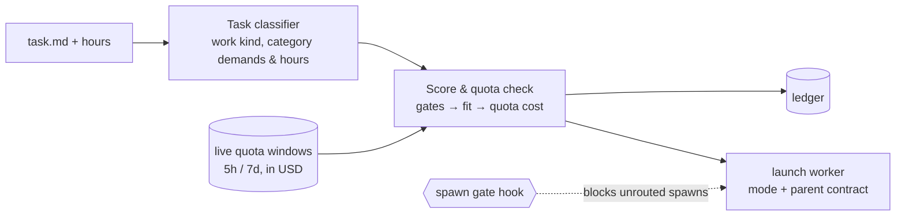

# AgentCompass Technical Reference & Operations Guide

Back to [README.md](../README.md).

## Contents

1. [How Scoring & Allocation Work](#1-how-scoring--allocation-work)
2. [Moving from a Git Checkout to the Installed Product](#2-moving-from-a-git-checkout-to-the-installed-product)
3. [Packaging, Incremental Updates & Runtime Ports](#3-packaging-incremental-updates--runtime-ports)
4. [Repository Layout](#4-repository-layout)
5. [Provider Inventory & Quota Collection](#5-provider-inventory--quota-collection)
6. [Windows Tray & Decision Console (`tray/`)](#6-windows-tray--decision-console-tray)
7. [Host Rollout & System-Level Skill Loading (`setup/`)](#7-host-rollout--system-level-skill-loading-setup)
8. [Deployment & Tests](#8-deployment--tests)

---

## 1. How Scoring & Allocation Work



```text
fit        = sum_a w_a * (min(z_a, t_a) - t1_a) / sum_a w_a   (in panel standard deviations; zero point t1_a = panel weakest)
targets    = t1: panel minimum, t2: panel median, t3: anchor (claude-opus-5-5 at High = 0.0)
continuity = max positive (t3 - t2) among highest-demand categories when coupling == "high", else 0
score N    = fit + continuity + boost - quota_cost
```

The classifier states how much the task needs (0–3) of `divergence`, `coding`, `aesthetics` and `tool_operation` (`tool_operation`
level 1 imposes no ability requirement; level 2 evaluates per-effort `responsiveness`; level 3 evaluates
`min(responsiveness, image_recognition)` and requires image input). A model's category scores are panel standard scores (`z`)
from public cited boards; a facet a model lacks is estimated from its same-series sibling or its `arena.ai` Overall tier fit (see
[`calibration/README.md`](../skills/agent-compass/calibration/README.md)). `quota_cost` is the quota economy: the part of the
task's spend that lands over the recovery line of the account's quota window, priced in panel-SD score units. Equal scores go to the
candidate on the earliest-expiring quota, then faster completion, then fewer USD.

Hard gates run first: sign-in and credential health, host policy, modality (text-only models never get visual work),
`local_only`, a demanded category with no data, and per-window safety reserves net of in-flight work. A bundle that draws from
several pools must clear every window; the tightest window binds. The same model on a different harness keeps its score
(Codex vs Pi is only a tie-break step for read-heavy vs. edit-heavy work). Unknown capacity stays unknown: the account stays
out of automatic routing until public data has it.
Category scores live in [`skills/agent-compass/references/five-axis-scores.json`](../skills/agent-compass/references/five-axis-scores.json),
and plan window structure in [`skills/agent-compass/references/plan-templates.json`](../skills/agent-compass/references/plan-templates.json).

| Layer | What it is | Required? |
|---|---|---|
| **Core**: [`skills/agent-compass`](../skills/agent-compass/SKILL.md) | Classifier, allocator, ledger, and `roll` (`classify → allocate → launch` with explicit permission mode and parent-session contract). Python 3.11+, Windows-first, POSIX-compatible. | **Yes** |
| **Gate**: [`setup/router_gate_hook.py`](../setup/router_gate_hook.py) | Pre-tool spawn gate and configured context rotation threshold (`rotate_after_carried_tokens`, set in the tray) check for hosts with pre-tool hooks. | Opt-in |
| **Tray**: [`tray/`](../tray/) | Windows system tray, decision console, quota view, and local bridges ([`gemini-web`](https://github.com/akiiwa-games/gemini-web), `codex-chatgpt-web`, `dot2api`, `easytier`). | Optional |

---

## 2. Moving from a Git Checkout to the Installed Product

A machine that ran AgentCompass from a git checkout keeps parts of it inside that checkout. The installed product
keeps them elsewhere, so move them once (every step has a dry run, is safe to repeat, and changes no account or rule):

```powershell
# 1. Plugin clones (usage-float, codex-chatgpt-web with its local patches, gemini-web, dot2api) -> ~/.agent-compass/plugins/<id>.
#    Closes the tray, stops each running plugin, moves the whole working tree (local changes and untracked files too),
#    replaces any junction that pointed back at the checkout, rebuilds dot2api's .venv, restarts what ran and the tray.
python -X utf8 <checkout>\tray\deploy.py migrate-plugins --dry-run
python -X utf8 <checkout>\tray\deploy.py migrate-plugins

# 2. The EasyTier node -> %ProgramData%\AgentCompass\easytier (asks for administrator rights through UAC).
#    Re-points the SYSTEM task at the new home, checks the node comes back (and sees the named peers), then deletes the
#    old copy; if it does not come back the task goes back to the old home. --keep-old keeps the old copy.
python -X utf8 <checkout>\tray\easytier_setup.py install --migrate-from <checkout>\easytier --dry-run
python -X utf8 <checkout>\tray\easytier_setup.py install --migrate-from <checkout>\easytier --expect-peer OTHER_HOST

# 3. The product itself: quit the checkout tray, run AgentCompass-tray-setup.exe from Releases, then re-run setup with
#    the installer's exe. Setup replaces hook, skill and rule entries that pointed at the checkout or a wheel.
& "$env:LOCALAPPDATA\AgentCompass\cli\agentcompass.exe" setup --yes --hooks

# 4. Remove a leftover wheel so it cannot shadow the installer's exe on PATH (`agentcompass doctor` prints the exact command).
uv tool uninstall agentcompass      # or: python -m pip uninstall -y agentcompass
```

The tray finds plugins and the EasyTier node at their old checkout locations until they are moved, so the steps can
run in any order. Host configs that still name a checkout path are listed at the end of step 1 for you to edit.

---

## 3. Packaging, Incremental Updates & Runtime Ports

- The router is a Python package, not a frozen executable: skills stay real directories because Claude, Codex and Antigravity read `SKILL.md`, and `agentcompass` runs the sibling scripts by path (`python -I`).
- A packaged install (no `.git`) checks [GitHub Releases](https://github.com/akiiwa-games/AgentCompass/releases) at most once per 6 hours (one cache shared by the tray's AgentCompass update and the integrations check; a failed read such as a rate limit falls back to the last good release, labelled with its time) and points the installer build at the tray's **Update AgentCompass** button and a uv install at `uv tool upgrade agentcompass`; a development checkout fast-forwards with git. `AGENTCOMPASS_GITHUB_ORG` and `AGENTCOMPASS_USAGE_FLOAT_REPO` override the org and the usage-float clone URL. Every `AGENTCOMPASS_*` variable that had a `ROUTE_MANAGER_*` name before the rename still accepts the old name.
- Tray extras: `pip install "agentcompass[tray]"`. `packaging/build.ps1` builds a one-folder PyInstaller tray (`AgentCompass.exe`) and CLI (`cli/agentcompass.exe`), a versioned application code package (`app-<version>.zip`), a release `manifest.json`, and with Inno Setup 6 a per-user installer (`AgentCompass-tray-setup.exe`, `PrivilegesRequired=lowest`) that registers the "AgentCompass" scheduled task (and removes the pre-rename "Route Manager" one); uninstall removes the task, the `PRO_CONSULT_*` / `CODEX_WEB_GPT_EXTERNAL_TRAY` variables and the Startup shortcuts. Builds are unsigned unless `AGENTCOMPASS_SIGNTOOL` and a certificate are set (SmartScreen will warn; see `packaging/SIGNING.md`). Tagged pushes (`v*`) attach the wheel, `AgentCompass-tray-setup.exe`, `app-<version>.zip` and `manifest.json` to the Release.
- **Incremental Windows updates (since `0.4.0`)**:
  - The Windows installer separates the frozen runtime (`_internal/`, `cli/_internal/`, boot executables `AgentCompass.exe` and `cli/agentcompass.exe`, and `runtime-info.json`) from application code (`app/current/`, unpacked from `app/packages/app-<version>.zip`, with the previous version retained at `app/previous/` for automatic startup/update rollback).
  - On update (`tray/updates.py`), an installed tray reads `manifest.json` from the Release and compares `runtime_fingerprint` (and `required_runtime_fingerprint` / `min_runtime_version` inside `app-<version>.zip`) against `<install>/runtime-info.json`.
  - **Code-package update (`app-<version>.zip`)** is used whenever the runtime fingerprint matches: only Python code (`tray/`, `agentcompass/`), bundled `skills/` and `setup/` files, policy data, `i18n_catalog.py`, and scripts like `tray/easytier_supervisor.ps1` changed. The updater downloads `app-<version>.zip`, verifies its SHA-256, atomically swaps `app/current/` (keeping `app/previous/`), refreshes public data, and restarts the tray. If `app/current/` ever fails to load at startup, `app_bootstrap.py` automatically falls back to `app/previous/`.
  - **Full installer update (`AgentCompass-tray-setup.exe`)** is required and chosen automatically when any part of the runtime changes:
    1. Python version or PyInstaller / boot executable loader (`packaging/app_bootstrap.py`, `packaging/tray_entry.py`, `packaging/cli_entry.py`) changes;
    2. Bundled third-party libraries with native extensions (`psutil`, `pystray`, `Pillow`, `pywin32`) are added, removed, or upgraded;
    3. `packaging/agentcompass.iss` installer actions change (scheduled task registration, environment variable writes/cleanup, shortcuts, uninstall cleanup, post-install `agentcompass setup`);
    4. `packaging/agentcompass-tray.spec` packaging configuration changes (exe names, icons, `hiddenimports`, files bundled into the runtime);
    5. The CLI executable's runtime portion (`cli/agentcompass.exe` / `cli/_internal/`) changes;
    6. The code package's `required_runtime_fingerprint` or `min_runtime_version` exceeds the installed runtime.
  - **Transition compatibility (`<=0.3.18` → `0.4.0`)**: Legacy clients (`<=0.3.18`) only look for `AgentCompass-tray-setup.exe` in a Release and upgrade to `0.4.0` through the full installer; from `0.4.0` onward, clients carry `runtime-info.json` and `app/current/` and use `app-<version>.zip` for subsequent code-only releases.
- Public reference data (model prices, new models, category scores, plan capacities, maintainer manual scores, classifier calibration; schema 3) updates between releases: `roll`/`plan` check the repository's `main` branch at most every 6 hours in the background, verify sha256 against `references/public-data.json`, and read the fetched set only when it is newer than the installed copy; your own local settings (`user-scores.json`, `accounts-override.json`, host policy) still win. `agentcompass data` shows the source, `agentcompass data --refresh` checks now, `AGENTCOMPASS_PUBLIC_DATA=off` disables it ([details](../skills/agent-compass/references/router-internals.md#5-public-reference-data-updates-between-releases)).
- Loopback ports default to Dot2API 8788, ChatGPT Web 17843, Gemini Web 17849, account login 17851, EasyTier 15888, Muse2API 18610. `AGENTCOMPASS_PORT_*` overrides `~/.agent-compass/ports.json`, which overrides the defaults; `doctor` reports conflicts.
- Paseo dispatch via `roll` needs Node.js: `npm --prefix setup/paseo-bridge ci` (the host rollout script does this when it detects Paseo).
- The demo uses a fixed synthetic quota snapshot and reference fleet, makes no network calls, writes no ledger and launches nothing. Add `--format json` for the full breakdown.

---

## 4. Repository Layout

Companion repositories and runtime directories are separate local checkouts or ignored host state, not bundled here.

| Path | Description |
|---|---|
| `skills/` | Agent skills (`agent-compass`, `dot-subagent`, `chatgpt-pro-consult`, `gemini-web`), loaded at the system level on every host via junctions in `~/.codex/skills`, `~/.claude/skills` (`~/.claude-*/skills`), `~/.pi/agent/skills`, `~/.gemini/config/skills.json` and materialized directories in `~/.gemini/skills`. |
| `tray/` | Windows tray and service supervisor: tray (`app.pyw`), decision console (`router_window.py`, `router_data.py`, `radar_chart.py`, `ui_theme.py`), plugin registry, service lifecycle, updater, the scheduler for the quota collector and capacity analytics. |
| `audit/` | `router_audit.py`: read-only daily check of sub-agent launches against `~/.agent-compass/router-ledger.jsonl`. |
| `setup/` | Onboarding (`onboard.py`), host sync (`sync_host_globals.py`, `host_rules.py`), spawn gate (`router_gate_hook.py`), Dot2API and Pi helpers, `claude2_config.py`. |
| `usage-float/`, `gemini-web/`, `dot2api/`, `codex-chatgpt-web/`, `easytier/`, `tools/bun/` | Companion checkouts and runtime state; see [usage-float](https://github.com/akiiwa-games/usage-float#readme) and [gemini-web](https://github.com/akiiwa-games/gemini-web#readme). |

---

## 5. Provider Inventory & Quota Collection

AgentCompass checks local account availability on every allocation through
[`skills/agent-compass/scripts/provider_inventory.py`](../skills/agent-compass/scripts/provider_inventory.py) without making network calls:

- **Local discovery**: Inspects native CLI sign-ins (`~/.claude`, `~/.claude-*`, `~/.codex`, `~/.codex-*`, `~/.grok`, `agy`), Paseo provider bindings (`~/.paseo/config.json`), CC Switch SQLite provider/health records, and Magpie gateway configurations (`usage-float.json` / `settings.json`).
- **Pause and resume**: Disabled or removed accounts, rejected credentials, or plugins turned off in the tray (`status=paused`, `reason=plugin_disabled_in_agentcompass`) are excluded on the next allocation and resume once credentials or plugins are restored.
- **Account states**: Each account has one state, used by dispatch and every account list ([`account_state.py`](../skills/agent-compass/scripts/account_state.py)). `ready`: the reading is good. `plan_inactive`: the plan is free, expired, cancelled or unpaid, the usage API answered 402 or a subscription error code, or a launch reported a lapse; excluded at once. `usage_failing`: the reading came back with an error, is missing, or (with no error) has not moved for 2 hours; shown at once with its reason and last good reading, dispatch carries a warning, and the account is excluded once that reading is 6 hours old (`AGENTCOMPASS_USAGE_FAILING_EXCLUDE_HOURS` or `scoring.usage_failing_exclude_hours`). `auth_failed`: 401/403; excluded at once. A good reading returns the account to `ready` with no action. `plan`/`roll` list all of these in `warnings`.
- **Plan sources**: The usage API's `plan_type` outranks the credential's claim, which is the fallback; a disagreement is a warning. An account's directory comes from its own configuration, never from `CLAUDE_CONFIG_DIR` or `CODEX_HOME` in the caller's environment, and a process with those pointing elsewhere does not publish `provider-inventory.json`. `plan_state_residue.py` lists what the earlier behaviour left behind (read-only).
- **Shared quota owners**: Multiple launchers or aliases pointing to the same subscription share one quota owner so concurrent tasks do not double-count remaining allowance.

Inspect the live inventory at any time:

```bash
agentcompass providers
```

### Subscription Quota Collection (`usage_collector.py`)

Quota windows are collected by [`usage_collector.py`](../skills/agent-compass/scripts/usage_collector.py) (`agentcompass usage` runs it once; the tray runs it every 5 minutes) into `~/.agent-compass/usage-cache.json` with a receipt at `~/.agent-compass/usage-collector.json`. Routing only reads that file (`agentcompass usage --show` prints it). The [usage-float](https://github.com/akiiwa-games/usage-float) display plugin is optional; if it has written `~/.usage-float/usage-cache.json`, the newer reading per provider is used, and `ROUTER_USAGE_CACHE` / `--usage-cache` name a single cache file when needed. The collector code derives from usage-float (MIT; see [THIRD_PARTY_NOTICES.md](../THIRD_PARTY_NOTICES.md)):

- **Multi-account discovery**: Detects primary and additional Claude/Codex homes (`~/.claude`, `~/.claude-*`, `~/.codex`, `~/.codex-*`), named Paseo accounts with configured homes, and remote Magpie gateways (`magpie_usage.py`).
- **Polling cadence**: Active accounts poll roughly every 5 minutes, idle accounts every 30 minutes, and accounts with unknown/stale activity every 15 minutes. Failed probes follow the same cadence and per-credential `429` backoff.
- **Read-only credential handling**: The collector never rotates or overwrites CLI OAuth tokens. Token refresh is left to the owning CLI (`claude`, `codex`, `agy`). Snapshots are bound to a one-way SHA-256 fingerprint of their credential source and updated via cross-process file locks and atomic file replacement.

### Adding an isolated Claude account

The account's Paseo provider extends Claude Code with both `CLAUDE_CONFIG_DIR` and `CLAUDE_SECURESTORAGE_CONFIG_DIR` set to its signed-in home. Keep both paths identical: an empty secure-storage path can select the primary account's credentials.

After signing in to the isolated home:
1. Close the Usage Float window (so its shutdown does not overwrite `config.json`).
2. Run `python setup/claude2_config.py --account team-backup --home <signed-in-home> --label 'Team backup'`. The script backs up existing settings, registers the named Paseo provider, enables that account's `7d` and `5h` Usage Float rows, and adds its projects directory to capacity analytics. The historical filename and no-argument `claude-2` default remain compatibility shortcuts.
3. Run `paseo reload` and reopen Usage Float.

---

## 6. Windows Tray & Decision Console (`tray/`)

### System Tray Menu

The tray menu is at most two levels deep and performs no blocking I/O or network probes when opened:

1. **Open AgentCompass** (default action on left-click) — opens the main decision and management panel.
2. **Pre-Reset Priority** — quick submenu to boost a subscription whose weekly quota is about to reset.
3. **One single-click entry per enabled window plugin**:
   - `Usage Float: …` — shows the floating HUD or auxiliary-screen panel.
   - `ChatGPT Web: …` — opens the ChatGPT Web launcher window.
   - `Gemini Web: …` — starts the dedicated Chrome profile and brings a Gemini / AI Studio tab to the front.
   - `EasyTier: …` — opens the mesh LAN status window.
4. **Exit** — closes the tray icon while leaving background bridges and services running (`app.pyw --attach-only` reconnects without starting paused services).

The tray icon displays a status dot: **green** when core usage collection and all enabled always-on plugins are healthy, **amber** while a pre-reset priority boost is active, and **red** when an enabled service has stopped.

### Main Panel Tabs (`tray/router_window.py`)

`router_window.py` runs in its own `pythonw` process so closing the window releases UI memory immediately:

- **Decision Console**:
  - **Dry-Run Simulator**: Test any task description or preset with custom hours, `local_only`, and `needs_visual` flags using `allocator.plan` without writing to the ledger.
  - **Ledger Replay**: Browse the last 30 router decisions and click any entry to replay its historical parameters against current live quota windows.
  - **Decision film**: A replayed decision plays as a short film (task → kind → routes → ranking → radar) that ends on the winner's name under the radar of the winner and the best-ranked other model (same-model routes share axis scores), with the five axis names on the radar. The radar's only backdrop is a hairline frame of full scale: the two shapes open from the centre, the winner last. Each model is a sheet of tinted glass: a vertical gradient of its hue, a denser rim, a highlight on the edges that face the light, and on the first sheet a few specks of light that twinkle until the film settles. The radar shows the two models' five values and nothing else; under it a strip names the two models and the task.
  - **Quota line** (third tab of the list card): for the replayed decision, each window is a small chart on its own clock: x is this period up to its reset, y is quota up to the period's capacity. The pale straight line is the quota line (the recovery line), and the thick line is actual usage rising up to now: green while it is under the quota line, red once it is over. The window's head says which: **Used first** under the line, **Held back** over it; it turns as the rising line crosses, and it ends as the state the decision saw, before this task. The line's colour, that word and the hover text read one and the same comparison. The usage line is solid where readings were recorded in this period and dotted when it is fitted from the period's start to the current usage; readings are display-only and the router's economics never read them. The window the chosen candidate draws from is lit and the task's spend continues its usage line in the accent colour; a task that runs past the reset is drawn up to the reset with the share of its spend that falls before it, and a mark on the reset edge says the rest belongs to the next period. Last, a dotted pace line runs from now to the reset corner, the pace that uses up what is left exactly at the reset. The snapshot is read field by field: a window whose usage or clock is not a number is left out, a capacity that is missing, zero or not a number is shown as unknown (plain usage line, no quota line, no state, no ratio), and a record the view cannot read at all never stops the rest of the decision from loading. At most four windows are shown: the chosen one always, then the other windows of its account, then the rest in recorded order; a note under the charts says how many are not shown or unreadable. The only words are window names, the two states and that note; hovering a chart gives the numbers, and a click replays. It plays on the film's clock. A simulation, a recomputed replay or a snapshot recorded without the block gets it derived from `decision.system.quota_windows` and each candidate's `economy` by the snapshot's own functions (`ledger_snapshot.with_quota_line`); the view is empty only when no candidate spent from a priced long window (the economy term is 0, and the view says so) or for a record older than the quota economy (`tray/quota_line.py` lists the snapshot fields it reads).
  - **Radar Comparison**: Switch between **Decision Score (5D)** (the winner against the best-ranked other model on creativity (`divergence`), coding, aesthetics, tool operation, and quota economy, mapped to `0..1` shares `(min(z, t3) - t1) / (t3 - t1)`) and **Model DNA (5D)** (any two models on the same five axes from their static profiles; quota economy there is price economy `1 − usd_per_hour / max_usd_per_hour`, not live quota). Each model is a sheet of tinted glass inside a hairline frame of full scale, and the chart shows the two models' five values and nothing else. Hovering any vertex shows the formula and raw values.
- **Account Quotas & In-Flight Tasks**:
  - Live status badges (`Ready`, `Paused`, `Plugin Disabled`, `Blocked by Host Policy`), remaining percentage and API-equivalent USD per window, 3h/24h burn rates, reset countdowns, one-click quota refresh, and active worker sessions with their cumulative uncompressed context against the configured context rotation threshold (`rotate_after_carried_tokens`, set in the tray).
- **Model Settings** — three tabs: **Models & Boost**, **Scores & Capabilities**, and **System Options**.
  - The home page shows discovered harness/account combinations, selected model chips and a model picker with select-all, invert and clear. Model discovery runs in the background through registered `paseo_provider`, `openai_compatible` or `static` probes. Discovered chat models become selectable bundles scored from their default profile (subscription pools on by default, metered proxies off); models the router cannot run are not listed. The account directory icon edits one shared, case-insensitive `cwd_regex`; legacy `allowed_cwd` prefixes remain readable. Preferences are sparse overrides with backups under `~/.agent-compass/backups/`.
  - Temporary priorities remain on the home page. **Scores & Capabilities** (`tray/panel_strategy.py`, `tray/score_overview.py`) holds the user's settings (weekly safety margin, short-window floor, context rotation threshold `rotate_after_carried_tokens`, and their presets), the four categories (Creativity `divergence`, Coding, Aesthetics, Tool operation) with their facets, boards, data dates, panel targets per level, coverage and the read-only continuity value with its derivation, the quota economy term, and every model's category levels on the 1–3 demand scale (`user_scores.z_to_level`, shown as 3.0+ above 3) with status and evidence on hover. Manual scores are entered and cleared there through `user_scores.set_score` / `clear_score`, the writer of `agentcompass score set|clear`, into the local file only.
  - **CLI updates** live in the home toolbar: **Update** checks and updates supported installs in the background, and **Auto-update daily** enables daily maintenance. Active CLI sessions defer their install's update and are never stopped. Provider environments select the same installation and npm prefix the router launches. Unknown/manual installs receive no guessed installer; Grok Bot's pinned build stays on Integrations. The CLI log opens from System Options.
- **Plugins & Services**:
  - Individual cards for every service and plugin with `Enabled` and `Autostart` toggles, health status, and service-specific controls.

### Services & Optional Plugins

State is stored atomically in `~/.agent-compass/plugins.json`:

| Service / Plugin | Window in Tray Menu | Autostarts by Default | Description |
|---|---|---|---|
| **Usage Collector & Capacity Stats** (`core`) | No (background) | Always on | Runs the router's collector (`agentcompass usage`) and `tray/capacity_stats.py --once` every 5 minutes, writing `~/.agent-compass/usage-cache.json` and `~/.agent-compass/capacity.json`. |
| `usage-float` | Yes | Yes | Borderless subscription quota HUD and live wallpaper switcher (`~/.agent-compass/plugins/usage-float`). |
| `chatgpt-web` | Yes | Yes | Local ChatGPT Web bridge (`127.0.0.1:17843`) run from `~/.agent-compass/plugins/chatgpt-web` with anchored patches from `tray/chatgpt_web_patch.py`. |
| `gemini-web` | Yes | No (on demand) | Dedicated Google Chrome profile with loopback CDP (`127.0.0.1:17849`) for Gemini, AI Studio, Flow, and Omni 1.1 video generation. |
| `easytier` | Yes | Yes | Per-host mesh VPN supervisor running `easytier-core.exe` (`127.0.0.1:15888` RPC portal) via a SYSTEM scheduled task. |
| `dot2api` | No (background) | Yes | Local Dot2API server (`127.0.0.1:8788`) exposed via a Cloudflared quick tunnel; `tray/dot_reconnect.py` automatically registers new tunnel URLs in ChatGPT and prunes stale plugin entries. |
| `muse2api` *(opt-in)* | No (background) | Once enabled | Clones `www222fff/muse2api` (`127.0.0.1:18610`, data in `~/.muse2api/data`) for headless Chrome muse.ai chat, image, and video generation. |

**Sign in & import** on the Muse2API card (`tray/account_login.py`) adds an account without DevTools or a browser extension. It opens installed Chrome on its own profile (`%LOCALAPPDATA%\AgentCompass Account Login\chrome-profile`, loopback CDP `127.0.0.1:17851`), waits up to 10 minutes for `hatch_sess` and `hatch_native_auth_device` on muse.ai, reads them over CDP, posts them to `/admin/accounts` (refreshing the existing account when the session is already imported), and closes the window. Cookies are never written to disk by the shell.

### Temporary Pre-Reset Priority

Selecting a model in the **Pre-Reset Priority** submenu applies a `+0.35` score boost to that subscription's weekly window for up to 24 hours (`~/.agent-compass/router-overrides.json`):
- Requires a fresh usage reading no older than 15 minutes and remaining weekly quota above `safety_margin_pct` (`5%`).
- Once the weekly window resets, the allocator latches `reset_confirmed_at` and retires the boost automatically, displaying a `Reset Confirmed` badge for 12 hours.

### EasyTier Mesh Setup

The node lives in `%ProgramData%\AgentCompass\easytier`: per machine like its task, outside any user profile, and untouched when the tray is reinstalled or uninstalled (both replace the installer's app directory). The tray remains unprivileged while `AgentCompass EasyTier` runs as a `SYSTEM` scheduled task (`SDDL GRGX` grants the interactive user only read/start/stop permissions on that task, while that folder, its `AgentCompass` parent, `bin/`, `private/`, `logs/`, and `state/` are writable only by `SYSTEM` and `Administrators`; a pre-made junction there is refused):

```powershell
python tray\easytier_setup.py check
python tray\easytier_setup.py install --binaries DIR --config THIS_HOSTS_TOML [--hook pre-start.ps1] [--legacy legacy.json] [--switch --expect-peer HOSTNAME]
python tray\easytier_setup.py install --migrate-from OLD_HOME [--expect-peer HOSTNAME] [--keep-old] [--dry-run]
python tray\easytier_setup.py switch|recover|rollback --expect-peer HOSTNAME
python tray\easytier_setup.py arm-recovery --expect-peer HOSTNAME --minutes 10
python tray\easytier_setup.py detach-switch --expect-peer HOSTNAME
python tray\easytier_setup.py cleanup
python tray\easytier_setup.py uninstall
```

A node installed before that folder existed lives in `<checkout>\easytier`; the tray keeps finding it there until `install --migrate-from <checkout>\easytier` moves it. A node registered before the AgentCompass rename still runs as `Route Manager EasyTier`; the tray reads either name, and `install` (with or without `--migrate-from`, elevated through UAC) registers `AgentCompass EasyTier`, deletes the old tasks and starts the new one.

---

## 7. Host Rollout & System-Level Skill Loading (`setup/`)

When landing AgentCompass on a machine, **system-level skill loading is required** so every coding agent session discovers `agent-compass` (and `dot-subagent`, `chatgpt-pro-consult`, `gemini-web`) regardless of the active workspace directory:

```powershell
# Synchronize system-level skills and global rules (AGENTS.md / CLAUDE.md / GEMINI.md / Paseo prompt)
python -X utf8 setup\sync_host_globals.py

# Also install (or keep refreshing) the PreToolUse / tool_call spawn gate
python -X utf8 setup\sync_host_globals.py --hooks

# Preview only, or undo everything this setup recorded
python -X utf8 setup\sync_host_globals.py --dry-run
python -X utf8 setup\sync_host_globals.py --uninstall
```

Safety properties of the sync (`agentcompass setup` runs the same code):

- **Your text is never replaced.** Rules go into a block between `<!-- agentcompass:begin -->` and `<!-- agentcompass:end -->`; anything outside it is kept. A file that is exactly an earlier generated copy is treated as wholly managed.
- **The shipped rules are a neutral English default** (`setup/host_rules.py`). To use your own wording, put `shared.md` (Claude, Pi, Gemini, OpenCode), `codex.md` and `daemon-append.md` (Paseo `appendSystemPrompt`) into `~/.agent-compass/host-rules/`; they are used verbatim, with `@@AGENTCOMPASS@@` (the router command: `agentcompass` when installed, otherwise `python -X utf8 <checkout>/agentcompass`), `@@ROUTER_HOOK_SCRIPT@@` and `@@HOME_POSIX@@` filled in; the old `python -X utf8 @@ROUTE_JUDGE@@` spelling is rewritten to it on every sync.
- **Every run that changes a file backs it up first** into `~/.agent-compass/backups/host-setup-<timestamp>/`, and records the change in `~/.agent-compass/setup-manifest.json`, which `--uninstall` / `agentcompass uninstall` reads to remove the blocks, hook entries, junctions and Paseo prompt again.
- **The spawn gate is opt-in** (`--hooks`). It blocks every sub-agent launch, including Claude Code's built-in Explore agent, unless `roll` recorded a routing decision in the last 15 minutes. Installations that already have the hook keep it up to date automatically.
- Harness directories (`~/.pi`, `~/.gemini`, `~/.config/opencode`, ...) are only written when that harness is installed.

**System-level skill loading by host harness:**
1. **OpenAI Codex (`~/.codex/skills/<name>`)**: Linked as directory junctions to `<repo>/skills/<name>`, with global delegation rules in `~/.codex/AGENTS.md` (and `~/.codex-*/AGENTS.md`).
2. **Claude Code (`~/.claude/skills/<name>` & `~/.claude-*/skills`)**: Linked via directory junctions to `~/.codex/skills/<name>`, with global rules in `~/.claude/CLAUDE.md` (and `~/.claude-*/CLAUDE.md`).
3. **Google Antigravity (`agy` / Gemini CLI)**:
   - Global skill roots must be registered as **absolute paths** in `~/.gemini/config/skills.json` (`~/.codex/skills`, `~/.agents/skills`, `~/.claude/skills`).
   - Because Antigravity's Go `os.ReadDir` 1-level scanner skips top-level Windows directory junctions (`ReparsePoint`), any junctioned skill in `~/.codex/skills` **must also be materialized as a real top-level directory** in `~/.gemini/skills/<name>` containing a real `SKILL.md` file and live directory junctions for `scripts/` and `references/` (automated by `setup/sync_host_globals.py`).
   - Global delegation rules must be synced to `~/.gemini/GEMINI.md` and `~/.gemini/config/GEMINI.md`.
4. **Pi (`~/.pi/agent/skills/<name>`) & OpenCode**: Populated with skill junctions and global `AGENTS.md` rules (`~/.pi/agent/AGENTS.md`, `~/.config/opencode/AGENTS.md`).
5. **Orca & T3 Code (orchestrator apps)**: Both run the real Claude Code / Codex CLIs on your own `~/.claude` and `~/.codex`, so those rules and skills already reach their agents. Orca additionally keeps a private Codex home per signed-in account (`<Orca userData>/codex-accounts/<id>/home`) and mirrors only `config.toml` into it, so `setup` writes the rules block and links the `agent-compass` skill there too. `roll` recognises an Orca session (`ORCA_AGENT_SESSION_ID` / `ORCA_TERMINAL_HANDLE`) and a T3 thread (`T3_MCP_URL` + `T3_MCP_BEARER_TOKEN`, or `--parent-host t3`) and returns the host's own launch command (`orca orchestration worker-start ...` / the T3 `delegate_task` MCP tool) instead of starting a CLI worker that could not report back. The gate hook blocks both launch paths without a router record.
6. **Paseo Daemon (`~/.paseo/config.json`)**: `daemon.appendSystemPrompt` must be updated via `setup/sync_host_globals.py` so Paseo-spawned sessions inherit the routing and worker communication contract.
7. **Cindy & Magpie (host-managed task / gateway plugins)**:
   - **[cindy-agentcompass-plugin](https://github.com/akiiwa-games/cindy-agentcompass-plugin)**: Cindy manages its own task creation, runs and message history (`cindy.tasks.create` / `send` / `getRun` / `readMessages`) and does not expose an addressable parent mailbox to child shells (raw shell `roll` in Cindy is refused). The Cindy plugin calls `agentcompass roll --parent-host native` purely for routing decisions and prompt packaging, then dispatches the task and collects `[Worker final report]` replies through Cindy's own task API.
   - **[magpie-agentcompass-router](https://github.com/akiiwa-games/magpie-agentcompass-router)**: [Magpie](https://github.com/yetone/magpie) manages its own local HTTP gateway and account pools. The Magpie plugin runs AgentCompass's task profiling and Model DNA routing at the gateway request layer (`magpie.hooks` → `magpie.middleware` and `/v1/systemone` decision provider) to select `<model>:<effort>` per turn.

---

## 8. Deployment & Tests

```powershell
# Deployment & service management
python tray\deploy.py check                        # Inspect current installation state
python tray\deploy.py install                      # Apply ChatGPT Web patches, build launcher, register logon task
python tray\deploy.py restart                      # Restart the tray UI without stopping background services
python tray\deploy.py all                          # Install and restart
python tray\deploy.py migrate-plugins [--dry-run]  # Move plugin clones out of a checkout into ~/.agent-compass/plugins
python tray\updates.py check                       # Check how many commits each managed repo is behind upstream
python tray\updates.py update                      # Fast-forward pull, rebuild, and restart enabled components
```

```powershell
# Hermetic pytest suites (isolated temp HOME/APPDATA per xdist worker; no manual env redirection needed)
pytest -n auto -m "not slow"    # Inner loop (fast unit and contract tests)
pytest -n auto                  # Pre-merge (full suite including subprocess, packaging, and Tk UI tests)
```
